# WinderDensity 1 — เอกสารสำหรับนักพัฒนา

โปรแกรมจำลองความหนาแน่น (Density) ของม้วนฟิล์ม Nylon (BOPA) บนเครื่อง Winder ที่มี Mill roll และ Contact roll
เขียนด้วย **Lazarus / Free Pascal + BGRABitmap** แยกหน้าต่าง Graphics และหน้าต่างข้อมูลสำหรับนักพัฒนา

> เอกสารชุดนี้อยู่ใน `WinderDensitySim\docs\` — รูปทั้งหมดอยู่ใน `docs\images\`
> โปรแกรมพี่น้อง: [WinderDensity 2](../../WinderDensitySim2/docs/README.md) (Tension roll + กระบอกลม),
> [WinderDensity 3](../../WinderDensitySim3/docs/README.md) (Linear motor + Servo + Cross/Top view + Manual Panel)

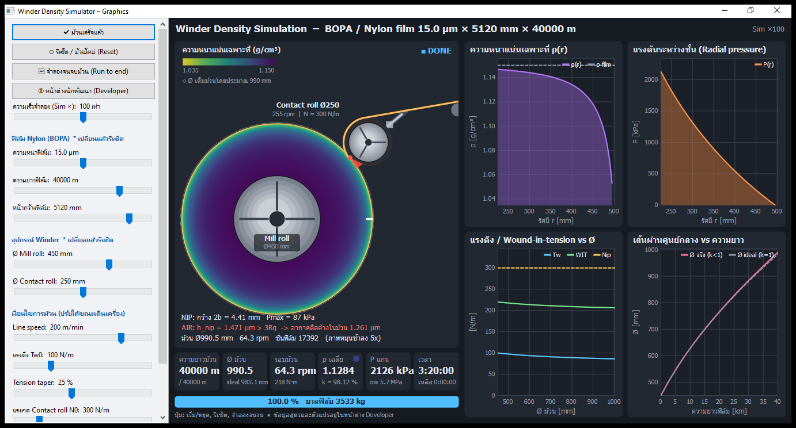

---

## สารบัญ

1. [ภาพรวม](#1-ภาพรวม)
2. [Build และ Run](#2-build-และ-run)
3. [เรขาคณิตของเครื่องและสมมติฐาน](#3-เรขาคณิตของเครื่องและสมมติฐาน)
4. [หน้าต่าง Graphics](#4-หน้าต่าง-graphics)
5. [หน้าต่าง Developer](#5-หน้าต่าง-developer)
6. [Export PNG / GIF](#6-export-png--gif)
7. [แบบจำลองทางฟิสิกส์และสูตรคำนวณ](#7-แบบจำลองทางฟิสิกส์และสูตรคำนวณ)
8. [พารามิเตอร์ทั้งหมด](#8-พารามิเตอร์ทั้งหมด)
9. [คำเตือน (Warnings)](#9-คำเตือน-warnings)
10. [ผลลัพธ์อ้างอิง](#10-ผลลัพธ์อ้างอิง)
11. [โครงสร้างโค้ด](#11-โครงสร้างโค้ด)
12. [วิธีเพิ่ม/แก้ไขความสามารถ](#12-วิธีเพิ่มแก้ไขความสามารถ)
13. [ข้อจำกัดและแนวทางพัฒนาต่อ](#13-ข้อจำกัดและแนวทางพัฒนาต่อ)
14. [ประวัติการเปลี่ยนแปลง](#14-ประวัติการเปลี่ยนแปลง)

---

## 1. ภาพรวม

| หัวข้อ | รายละเอียด |
|---|---|
| วัตถุประสงค์ | จำลองการม้วนฟิล์มทีละชั้น และคำนวณความหนาแน่นเฉพาะที่ ρ(r), แรงดันระหว่างชั้น P(r), Ø ม้วน, อากาศที่ติดในม้วน |
| ฟิล์ม | Nylon / BOPA หนา 10–25 µm, ยาว 25,000–50,000 m, หน้ากว้างค่าตั้งต้น 5120 mm |
| ความเร็วไลน์ | 120–250 m/min |
| อุปกรณ์ | Winder (center drive), Mill roll Ø450 mm (แกนม้วน), Contact roll Ø250 mm (หุ้มยาง) บนรางแนวรัศมี, Idler roll |
| ภาษา / Library | Free Pascal (`{$mode objfpc}`), LCL, **BGRABitmap** (วาดภาพทั้งหมด), BGRAAnimatedGif (GIF) |
| หน้าต่าง | **Graphics** (หลัก) และ **Developer data** (แยกหน้าต่าง) |
| ขนาดโค้ด | 7 ไฟล์ ~2,550 บรรทัด |

---

## 2. Build และ Run

### ความต้องการ

* Lazarus (ทดสอบกับ `C:\lazarus`, FPC 3.2.2, Win64)
* แพ็กเกจ **BGRABitmapPack** (ติดตั้งผ่าน Online Package Manager — อยู่ที่ `%LOCALAPPDATA%\lazarus\onlinepackagemanager\packages\BGRABitmap`)

### Build

เปิด `WinderDensity.lpi` ใน Lazarus แล้วกด **F9** หรือใช้ command line:

```bash
C:\lazarus\lazbuild.exe WinderDensity.lpi
```

* Build mode `Default` → `WinderDensity.exe` (โฟลเดอร์โปรเจกต์), unit ไปที่ `lib\x86_64-win64\`
* Build mode `Debug` (เพิ่มภายหลังใน .lpi) — เปิด Range/Overflow/IO/Stack checks + HeapTrc เหมาะสำหรับหา bug
* ถ้าโปรแกรมเปิดค้างอยู่ จะ link ไม่ได้ (`Can't create object file ... error code: 5`) ให้ปิดโปรแกรมก่อน

### Command line (สำหรับทดสอบอัตโนมัติ / ทำภาพเอกสาร)

| Option | ผล |
|---|---|
| `end` | จำลองจนจบม้วนทันที |
| `dev` | เปิดหน้าต่าง Developer |
| `devtab=<n>` | เปิดหน้าต่าง Developer ที่แท็บ n (0 Live, 1 Formulas, 2 Layer table, 3 Coefficients, 4 Export) |
| `devexport` | เปิดแท็บ Export |
| `png:<view>:<file>` | Export PNG ของหน้า view (0 = Graphics, 1 = Developer) แล้วทำงานต่อ |
| `gif:<view>:<file>` | Export GIF แบบ Time-lapse 20 เฟรม (เดินม้วนจนจบ) |

ตัวอย่าง:

```bash
WinderDensity.exe end devtab=2
```

### คีย์ลัด

| คีย์ | ผล |
|---|---|
| Space | เริ่ม / หยุด |
| R | รีเซ็ตม้วน |
| E | จำลองจนจบม้วน |
| F12 | หน้าต่าง Developer |

---

## 3. เรขาคณิตของเครื่องและสมมติฐาน

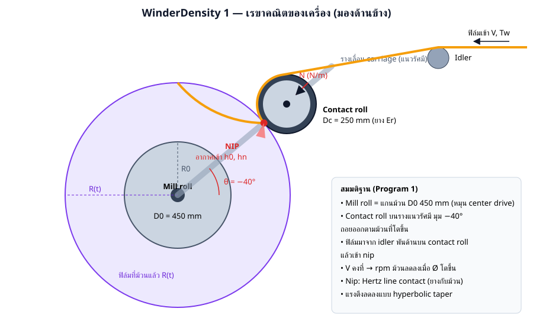

* **Mill roll** = แกนที่ฟิล์มม้วนเข้าไป Ø D0 = 450 mm (ตีความจากโจทย์: ฟิล์ม 50,000 m × 25 µm ม้วนแล้ว Ø ≈ 1.34 m จึงไม่ใช่ Ø ของม้วนเต็ม)
* **Contact roll** (Dc = 250 mm, หุ้มยาง Er ≈ 6 MPa) อยู่บนรางเลื่อนแนวรัศมี ทำมุม θ = −40° (ขวา-บน) กดฟิล์มเข้าหาม้วนด้วยแรง N (N/m)
* ฟิล์มมาจาก **Idler** ทางขวาบน พันด้านบนของ Contact roll ประมาณ 120° แล้วเข้า **nip**
* Winder เป็น **center drive** ความเร็วผิว V คงที่ → rpm ลดลงเมื่อม้วนโต
* ภาพหมุนช้าลง 5 เท่า (`× 0.2`) เพื่อไม่ให้เกิด stroboscopic effect

---

## 4. หน้าต่าง Graphics

| ตอนเริ่ม | ตอนม้วนเสร็จ |
|---|---|
| 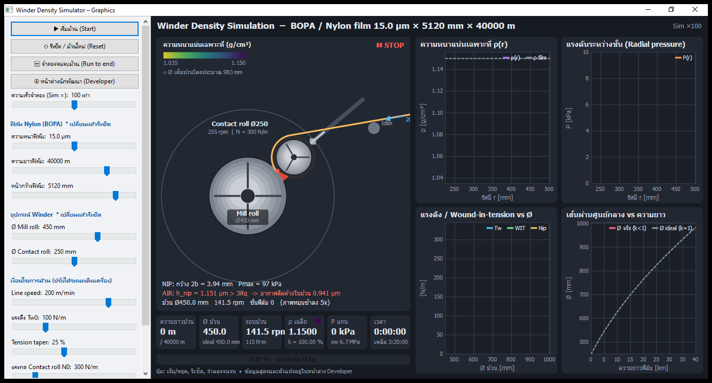 |  |

### ส่วนประกอบของภาพ (`RenderScene` ใน `uwinderdraw.pas`)

| ส่วน | รายละเอียด |
|---|---|
| ภาพเครื่อง (ซ้าย) | ม้วนแสดงเป็นวงแหวน 90 แถบ สีตามความหนาแน่น (viridis: เหลือง = ต่ำ, ม่วงเข้ม = สูง 0.90–1.00 ของ ρf), วงประ = Ø ม้วนเต็มโดยประมาณ, ลิ่มที่ nip = อากาศ (แดง = ติดค้าง, ฟ้า = ระบายได้) |
| ข้อความใต้ภาพ | NIP 2b / Pmax, AIR h_nip เทียบ 3Rq, Ø, rpm, จำนวนชั้น |
| KPI 6 ช่อง | ความยาวม้วน, Ø ม้วน (เทียบ ideal), รอบม้วน + แรงบิด, ρ เฉลี่ย + k, P ที่แกน + σw, เวลา/เวลาที่เหลือ |
| Progress bar | % ความยาว + มวลฟิล์ม |
| กราฟ 1 | ความหนาแน่นเฉพาะที่ ρ(r) เทียบ ρ film |
| กราฟ 2 | แรงดันระหว่างชั้น P(r) [kPa] |
| กราฟ 3 | Tw, WIT, Nip เทียบ Ø ม้วน |
| กราฟ 4 | Ø จริง (k<1) เทียบ Ø ideal (k=1) ตามความยาว [km] |

### แถบควบคุม (`TParamSlider` ใน `umain.pas`)

| Slider | ช่วง | ขั้น | ค่าตั้งต้น | เปลี่ยนแล้วรีเซ็ตม้วน |
|---|---|---|---|---|
| ความเร็วจำลอง (Sim ×) | 1–10,000 (log, 10^(pos/10)) | — | 100 | ไม่ |
| ความหนาฟิล์ม | 10–25 µm | 0.5 | 15 | ใช่ |
| ความยาวฟิล์ม | 25,000–50,000 m | 500 | 40,000 | ใช่ |
| หน้ากว้างฟิล์ม | 500–6,000 mm | 10 | 5,120 | ใช่ |
| Ø Mill roll | 300–600 mm | 10 | 450 | ใช่ |
| Ø Contact roll | 150–400 mm | 10 | 250 | ใช่ |
| Line speed | 120–250 m/min | 1 | 200 | ไม่ (มีผลกับชั้นใหม่) |
| แรงตึง Tw0 | 30–300 N/m | 5 | 100 | ไม่ |
| Tension taper | 0–60 % | 1 | 25 | ไม่ |
| แรงกด Contact roll N0 | 50–1,500 N/m | 10 | 300 | ไม่ |
| Nip taper | 0–60 % | 1 | 0 | ไม่ |

ปุ่ม: เริ่ม/หยุด, รีเซ็ต, จำลองจนจบม้วน, หน้าต่างนักพัฒนา

---

## 5. หน้าต่าง Developer

`uDevForm.TfrmDev` — หน้าต่างแยก มี 5 แท็บ ปุ่ม **Refresh** และ **Export layers CSV...** ด้านล่าง
ขณะเครื่องเดิน หน้าต่างนี้อัปเดตทุก ~0.5 วินาที (ทุก 15 tick ของ timer)

| แท็บ | รายละเอียด | ภาพ |
|---|---|---|
| Live data | ค่าทุกตัว: input, state, kinematics, tension/stress, nip, air, ผลความหนาแน่น, คำเตือน (อัปเดตแบบไม่เลื่อน scroll) | 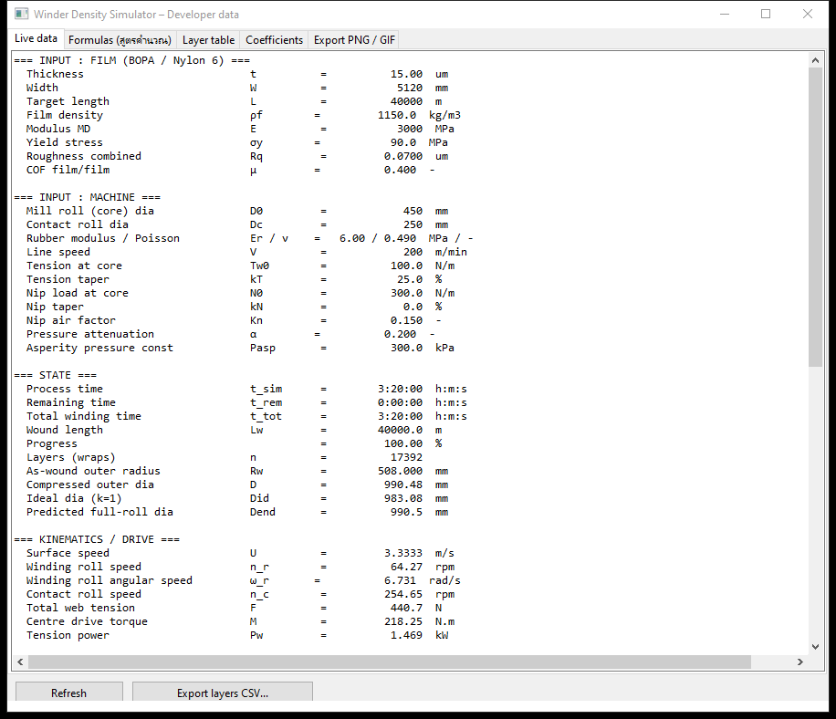 |
| Formulas (สูตรคำนวณ) | สูตรทั้งหมด (ตรงกับหัวข้อ 7) | 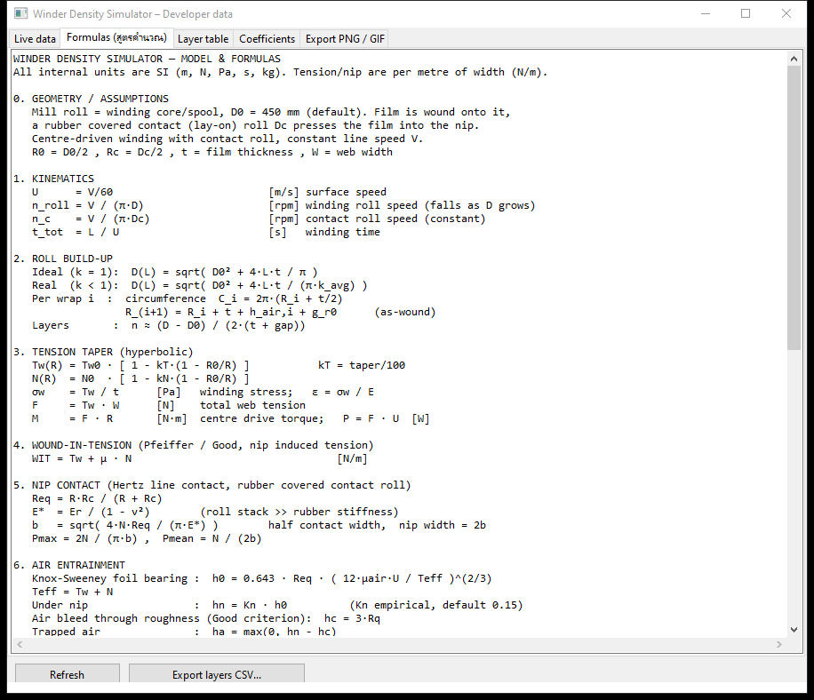 |
| Layer table | ตารางรายชั้น (สุ่มตัวอย่างไม่เกิน 300 แถว): R wound, R comp, L cum, Tw, Nip, WIT, P, h_air0, gap, k, ρ | 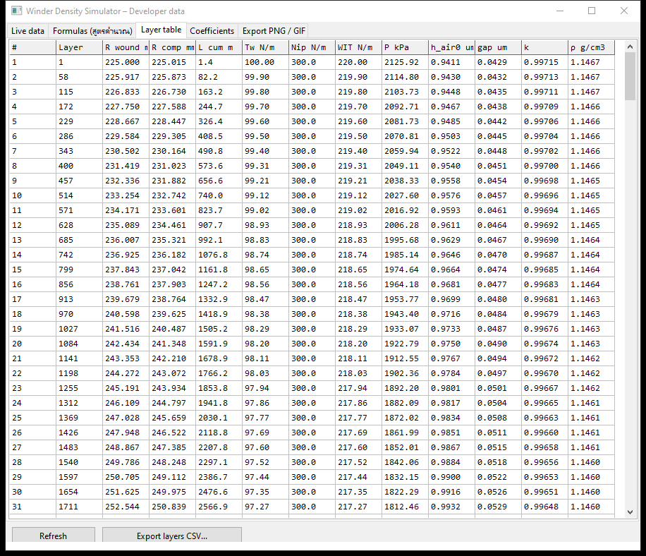 |
| Coefficients | แก้ค่าคงที่ทางฟิสิกส์ด้วย `TValueListEditor` → **Apply** (รีเซ็ตม้วน) / **Load defaults** | 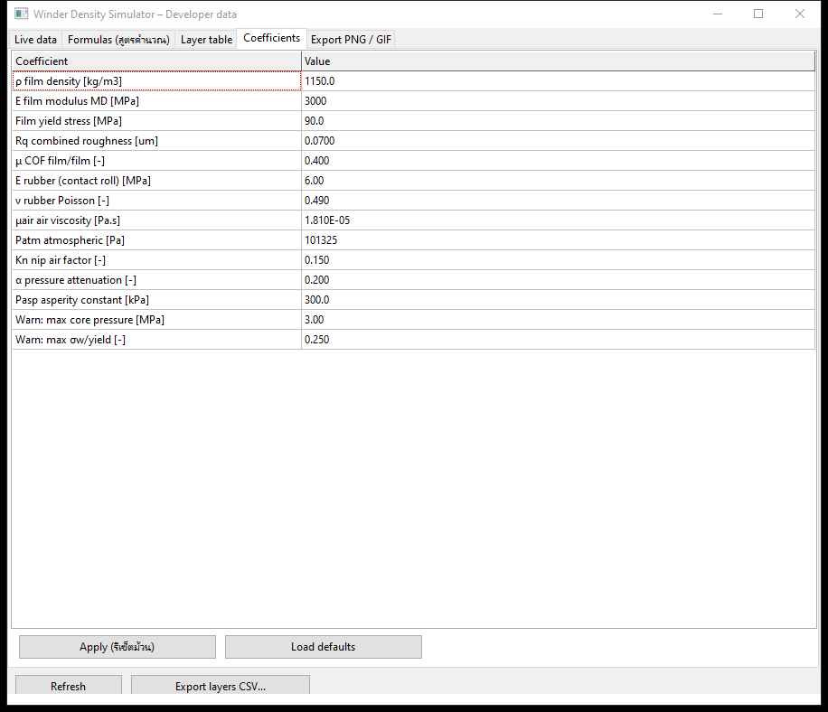 |
| Export PNG / GIF | ดูหัวข้อ 6 | 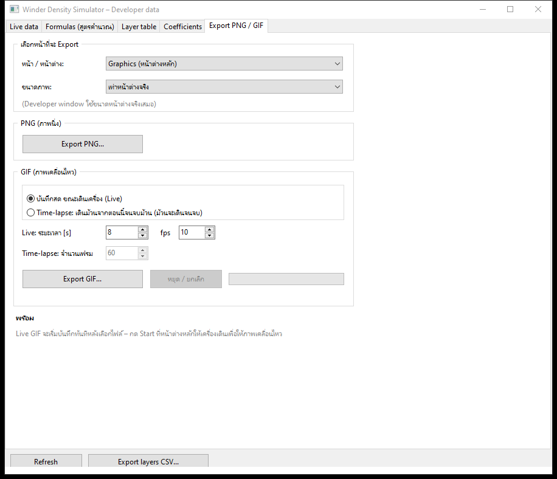 |

**Export layers CSV** — บันทึกทุกชั้น (ไม่สุ่ม) คอลัมน์:
`layer, R_wound_mm, R_comp_mm, L_cum_m, Tw_N_m, Nip_N_m, WIT_N_m, P_kPa, h_air0_um, gap_um, k, rho_g_cm3`
ใช้จุดทศนิยม `.` เสมอ (`FSDot`) ไม่ขึ้นกับ locale

---

## 6. Export PNG / GIF

`uExportTab.TExportPanel` (ไฟล์เดียวกันทั้ง 3 โปรแกรม)

| ตัวเลือก | ค่า |
|---|---|
| หน้า / หน้าต่าง | `Graphics (หน้าต่างหลัก)`, `Developer window (หน้านี้)` |
| ขนาดภาพ | เท่าหน้าต่างจริง, 960×540, 1280×720, 1600×900, 1920×1080 (Developer window ใช้ขนาดจริงเสมอ; ถ้าหน้าต่างยังไม่แสดง ใช้ 1280×720) |
| PNG | ภาพนิ่ง 1 ภาพ (`TBGRABitmap.SaveToFile`) |
| GIF – Live | บันทึกขณะเดินเครื่อง 1–120 s, 1–25 fps (TTimer) — กด Start ที่หน้าต่างหลักให้ภาพเคลื่อนไหว |
| GIF – Time-lapse | เดินม้วนจากตอนนี้จนจบ แบ่งความยาวเท่า ๆ กัน 5–300 เฟรม (เฟรมสุดท้ายค้าง 2.5 s) — **ม้วนจะเดินจนจบจริง** |

ตัวอย่าง Time-lapse ([timelapse.gif](images/timelapse.gif), 20 เฟรม 1280×720 ~3.9 MB):

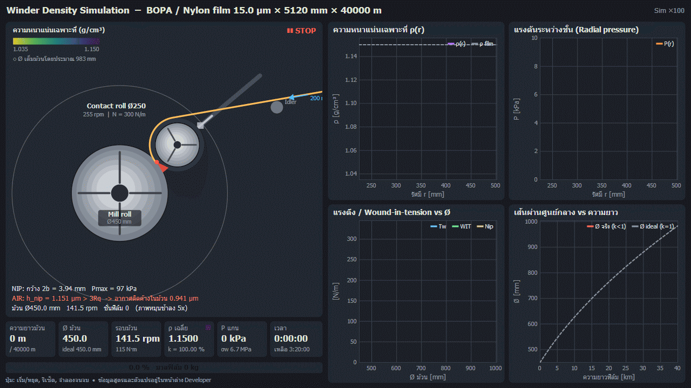

หมายเหตุทางเทคนิค
* GIF ใช้ `TBGRAAnimatedGif.AddFullFrame(..., AOwned=True)` และต้องตั้ง `BGRAColorQuantizerFactory := TBGRAColorQuantizer` (ทำใน `initialization` ของ `uExportTab`) ไม่เช่นนั้นจะได้ไฟล์ 32 byte
* GIF มี 256 สีต่อเฟรม ไฟล์ ~0.2 MB/เฟรมที่ 1280×720 — ใช้ 960×540 ถ้าต้องการไฟล์เล็ก

---

## 7. แบบจำลองทางฟิสิกส์และสูตรคำนวณ

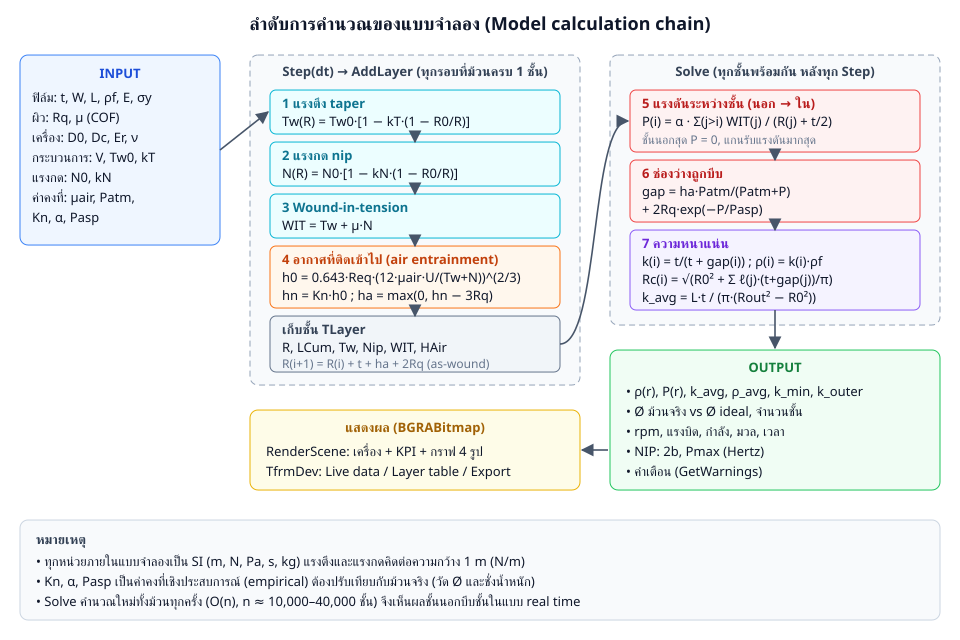

หน่วยภายในทั้งหมดเป็น SI (m, N, Pa, s, kg) แรงตึงและแรงกดคิด **ต่อความกว้าง 1 m (N/m)**

### 7.0 สัญลักษณ์

| สัญลักษณ์ | ความหมาย | หน่วย |
|---|---|---|
| t | ความหนาฟิล์ม | m |
| W | หน้ากว้างฟิล์ม | m |
| L | ความยาวฟิล์ม | m |
| R0 = D0/2 | รัศมี Mill roll | m |
| Rc = Dc/2 | รัศมี Contact roll | m |
| R | รัศมีม้วนปัจจุบัน | m |
| V, U = V/60 | ความเร็วไลน์, ความเร็วผิว | m/min, m/s |
| Tw | แรงตึงฟิล์ม (หลัง taper) | N/m |
| N | แรงกด nip (หลัง taper) | N/m |
| ρf | ความหนาแน่นเนื้อฟิล์ม | kg/m³ |
| k | packing ratio (สัดส่วนเนื้อฟิล์มในปริมาตรม้วน) | – |

### 7.1 Kinematics

```
U       = V / 60                    [m/s]
n_roll  = V / (π·D)                 [rpm]   ลดลงเมื่อ D โตขึ้น
ω_roll  = U / R                     [rad/s]
n_c     = V / (π·Dc)                [rpm]   คงที่
t_total = L / U                     [s]
```

### 7.2 การโตของม้วน

```
Ideal (k = 1) : D(L) = √( D0² + 4·L·t / π )
Real  (k < 1) : D(L) = √( D0² + 4·L·t / (π·k_avg) )
ต่อชั้น i      : C_i = 2π·(R_i + t/2)
               R_(i+1) = R_i + t + h_air,i + g_r0          (as-wound)
จำนวนชั้น      : n ≈ (D − D0) / (2·(t + gap))
```

### 7.3 Tension taper (hyperbolic)

```
Tw(R) = Tw0 · [ 1 − kT·(1 − R0/R) ]        kT = taper/100
N(R)  = N0  · [ 1 − kN·(1 − R0/R) ]
σw    = Tw / t          [Pa]   winding stress ;  ε = σw / E
F     = Tw · W          [N]    แรงตึงรวม
M     = F · R           [N·m]  แรงบิด center drive ;  P = F · U  [W]
```

### 7.4 Wound-in-tension (Pfeiffer / Good)

```
WIT = Tw + μ · N        [N/m]
```

### 7.5 Nip contact (Hertz line contact, Contact roll หุ้มยาง)

```
Req   = R·Rc / (R + Rc)
E*    = Er / (1 − ν²)                (ม้วนแข็งกว่ายางมาก)
b     = √( 4·N·Req / (π·E*) )        nip width = 2b
Pmax  = 2N / (π·b) ,  Pmean = N / (2b)
```

### 7.6 อากาศที่ติดเข้าไป (Air entrainment)

```
Knox-Sweeney  : h0 = 0.643 · Req · ( 12·μair·U / Teff )^(2/3) ,  Teff = Tw + N
ใต้ nip        : hn = Kn · h0               (Kn empirical, default 0.15)
ระบายผ่านผิว   : hc = 3·Rq                   (Good criterion)
อากาศติดค้าง   : ha = max(0, hn − hc)
```

* V สูง → อากาศมาก → ρ ต่ำ ; N หรือ Tw สูง → อากาศน้อย → ρ สูง

### 7.7 แรงดันระหว่างชั้น (Radial pressure)

ทุกชั้นด้านนอกเพิ่มแรงดัน WIT/R ให้ชั้นด้านใน (thin ring / membrane):

```
P_i = α · Σ_(j>i) WIT_j / (R_j + t/2)          [Pa]
```

α = ค่าลดทอน (stack compliance + hoop relaxation แบบง่ายของ Hakiel/Altmann) ค่าตั้งต้น 0.20

### 7.8 การบีบช่องว่าง

```
อากาศ (Boyle isothermal) : h_air(P) = ha · Patm / (Patm + P)
ผิวขรุขระ (asperities)    : g_r(P)   = g_r0 · exp(−P / Pasp) ,  g_r0 = 2·Rq
gap_i = h_air(P_i) + g_r(P_i)
```

### 7.9 ความหนาแน่น

```
k_i    = t / (t + gap_i)
ρ_i    = k_i · ρf
Rc_i   = √( R0² + Σ_(j≤i) ℓ_j·(t + gap_j) / π )     ℓ_j = ความยาวฟิล์มของชั้น j (area conservation)
k_avg  = L·t / ( π·(Rout² − R0²) )
ρ_avg  = k_avg · ρf = m / V_roll
φ_air  = 1 − k_avg
m      = ρf · t · W · L
```

> **สำคัญ:** รัศมีหลังบีบ (`Rc_i`) ใช้หลักอนุรักษ์พื้นที่หน้าตัด (ความยาวฟิล์มคงที่) ไม่ใช่บวกความหนาตรง ๆ —
> ถ้าบวกตรง ๆ จะได้ Ø เล็กกว่า ideal และ k = 100% ซึ่งผิด (เป็น bug ที่แก้แล้ว)

### 7.10 ค่าวัสดุ BOPA (Nylon 6) โดยทั่วไป

| ค่า | ช่วงทั่วไป |
|---|---|
| ρf | 1.14–1.16 g/cm³ |
| E (MD) | 2–4 GPa |
| σy | 60–100 MPa |
| μ film/film | 0.3–0.6 |
| Winding stress | 4–12 MPa (Tw ≈ 60–180 N/m ที่ 15 µm) |
| ยาง Contact roll | 60–80 Shore A → Er ≈ 4–9 MPa |

---

## 8. พารามิเตอร์ทั้งหมด

`TWinderParams` (`uwindermodel.pas`) ค่าตั้งต้นใน `TWinderSim.SetDefaults`

| Field | ความหมาย | หน่วย | ค่าตั้งต้น | แก้ที่ |
|---|---|---|---|---|
| ThickUm | ความหนาฟิล์ม | µm | 15 | Slider |
| WidthMm | หน้ากว้าง | mm | 5120 | Slider |
| LengthM | ความยาวเป้าหมาย | m | 40000 | Slider |
| RhoFilm | ความหนาแน่นฟิล์ม | kg/m³ | 1150 | Coefficients |
| EFilmMPa | Modulus MD | MPa | 3000 | Coefficients |
| YieldMPa | Yield stress | MPa | 90 | Coefficients |
| RqUm | ความขรุขระรวม 2 ผิว | µm | 0.07 | Coefficients |
| COF | สัมประสิทธิ์แรงเสียดทานฟิล์ม/ฟิล์ม | – | 0.40 | Coefficients |
| CoreDiaMm | Ø Mill roll | mm | 450 | Slider |
| ContactDiaMm | Ø Contact roll | mm | 250 | Slider |
| RubberEMPa | Modulus ยาง | MPa | 6 | Coefficients |
| RubberNu | Poisson ยาง | – | 0.49 | Coefficients |
| SpeedMpm | ความเร็วไลน์ | m/min | 200 | Slider |
| TensionNm | แรงตึงที่แกน Tw0 | N/m | 100 | Slider |
| TaperPct | Tension taper | % | 25 | Slider |
| NipNm | แรงกดที่แกน N0 | N/m | 300 | Slider |
| NipTaperPct | Nip taper | % | 0 | Slider |
| AirVisc | ความหนืดอากาศ | Pa·s | 1.81e-5 | Coefficients |
| Patm | ความดันบรรยากาศ | Pa | 101325 | Coefficients |
| NipAirFactor (Kn) | ลดอากาศโดย nip | – | 0.15 | Coefficients |
| PressAtten (α) | ลดทอนแรงดัน | – | 0.20 | Coefficients |
| AspPressKPa (Pasp) | ค่าคงที่การบีบผิว | kPa | 300 | Coefficients |
| MaxCorePressMPa | เกณฑ์เตือนแรงดันแกน | MPa | 3.0 | Coefficients |
| MaxStressRatio | เกณฑ์เตือน σw/σy | – | 0.25 | Coefficients |

ข้อมูลต่อชั้น `TLayer`: `R, LCum, Tw, Nip, WIT, HAir` (ตอนม้วน) และ `P, Gap, K, Rc` (คำนวณใน `Solve`)

---

## 9. คำเตือน (Warnings)

จาก `TWinderSim.GetWarnings` (แสดงใน Live data):

| Tag | เงื่อนไข | ความหมาย |
|---|---|---|
| `[AIR]` | hn > 3Rq | อากาศติดค้าง → ม้วนนิ่ม / telescoping — เพิ่มแรงกดหรือลดความเร็ว |
| `[TENSION]` | σw > MaxStressRatio·σy | แรงตึงเกิน → ฟิล์มยืด / gauge band / แกนยุบ |
| `[CORE]` | P_core > MaxCorePressMPa | blocking / แกนยุบ → เพิ่ม taper |
| `[SOFT]` | k_outer < 0.95 (เมื่อ > 100 ชั้น) | ชั้นนอกนิ่ม เสียหายง่ายตอนขนย้าย |
| `[TAPER]` | Tw < 30% Tw0 | เสี่ยงย่น |
| `[NIP]` | Pmax > 1 MPa | รอยกด |

---

## 10. ผลลัพธ์อ้างอิง

ค่าตั้งต้น: ฟิล์ม 15 µm × 5120 mm × 40,000 m, V = 200 m/min, Tw0 = 100 N/m (taper 25%), N0 = 300 N/m

| ค่า | ผล |
|---|---|
| Ø ม้วนเต็ม | 990.5 mm (ideal k=1: 983.1 mm) |
| k_avg / ρ_avg | 98.12 % / 1.1284 g/cm³ |
| แรงดันที่แกน | 2,126 kPa |
| จำนวนชั้น | 17,392 |
| รอบม้วนตอนจบ | 64.3 rpm (ตอนเริ่ม 141.5 rpm) |
| แรงบิดตอนจบ | 218 N·m |
| มวลฟิล์ม | 3,533 kg |
| เวลาม้วน | 3:20:00 |
| Nip ตอนจบ | 2b = 4.41 mm, Pmax = 87 kPa |
| อากาศตอนจบ | hn = 1.471 µm > 3Rq (0.21 µm) → ติดค้าง 1.261 µm/ชั้น |
| σw ตอนจบ | 5.7 MPa (ตอนเริ่ม 6.7 MPa) |

ใช้ค่าเหล่านี้เป็น regression check เมื่อแก้แบบจำลอง

---

## 11. โครงสร้างโค้ด

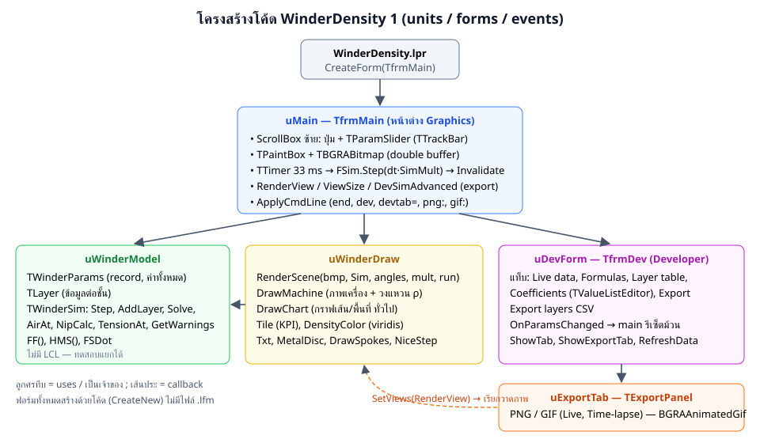

### ไฟล์

| ไฟล์ | บรรทัด | หน้าที่ |
|---|---|---|
| `WinderDensity.lpr` | 20 | program, `RequireDerivedFormResource := False`, สร้าง `TfrmMain` |
| `WinderDensity.lpi` | 121 | project (ต้องการ `BGRABitmapPack`, `LCL`; build mode Default + Debug) |
| `uwindermodel.pas` | 512 | แบบจำลองทั้งหมด (ไม่มี LCL — นำไปทดสอบแยกได้) |
| `uwinderdraw.pas` | 508 | วาดภาพด้วย BGRABitmap: `RenderScene`, `DrawMachine`, `DrawChart`, `Tile` |
| `umain.pas` | ~460 | หน้าต่าง Graphics, sliders, timer, export callbacks, command line |
| `udevform.pas` | ~560 | หน้าต่าง Developer (5 แท็บ) |
| `uexporttab.pas` | 408 | แท็บ Export PNG/GIF (ใช้ร่วม 3 โปรแกรม) |

### ลำดับการทำงานหลัก

```
TTimer (33 ms) ─► TfrmMain.TimerTick
                   ├─ dt = เวลาจริง (≤ 0.2 s)
                   ├─ FSim.Step(dt · SimMult)       ← ม้วนต่อ
                   │     └─ while ยาวพอครบชั้น → AddLayer   (Tw, N, WIT, ha ของชั้นนั้น)
                   │     └─ Solve                          (P, gap, k, Rc ทุกชั้น)
                   ├─ มุมหมุนภาพ += ω·dt·0.2
                   ├─ PBox.Invalidate ─► PBoxPaint ─► RenderScene(FBmp) ─► FBmp.Draw(Canvas)
                   └─ ทุก 15 tick: FDev.RefreshData (ถ้าเปิดอยู่)
```

* **RunToEnd** เรียก `Step(10 s, DoSolve=False)` วนจนจบแล้ว `Solve` ครั้งเดียว (เร็ว)
* `Layers` เป็น dynamic array ขยายแบบ ×2 (`Count` = จำนวนที่ใช้จริง)

### หลักการเขียนโค้ดที่ต้องระวัง

1. **ฟอร์มสร้างด้วยโค้ดทั้งหมด** — constructor `Create` override แล้วเรียก `inherited CreateNew(AOwner, 1)` ไม่มีไฟล์ `.lfm`
2. **`with` + ชื่อซ้ำ** — Pascal ไม่สนตัวพิมพ์เล็ก/ใหญ่ ภายใน `with Layers[i] do` ตัวแปร `r` จะชี้ไป `Layers[i].R` และ `P` ชี้ไป `Layers[i].P` (ไม่ใช่ `Self.P`) — เคยเป็น bug ใน `Solve` แก้โดยใช้ `rr`, `patm` และ `Self.P.COF`
3. **ข้อความภาษาไทย** — ไฟล์เป็น UTF-8 ไม่มี BOM และ **ไม่ใส่** `{$codepage utf8}` (LCL ใช้ UTF-8 string อยู่แล้ว)
4. **ตัวเลข** — ใช้ `FF(v, d)` / `FSDot` (จุดทศนิยม `.`) สำหรับข้อความและ CSV ทุกที่
5. **BGRABitmap** — วาดลง `TBGRABitmap` ขนาดเท่า PaintBox แล้ว `Draw(Canvas, 0, 0, True)`; ข้อความใช้ `FontQuality := fqSystemClearType`, font Tahoma (รองรับไทย)

### ฟังก์ชันสำคัญใน `TWinderSim`

| ฟังก์ชัน | หน้าที่ |
|---|---|
| `SetDefaults`, `Reset` | ค่าตั้งต้น / ล้างม้วน |
| `Step(dt, DoSolve)` | เพิ่มความยาว U·dt, สร้างชั้นเมื่อครบเส้นรอบวง |
| `AddLayer` | คำนวณ Tw, N, WIT, ha ของชั้นใหม่ |
| `Solve` | P (นอก→ใน), gap, k, Rc (ใน→นอก), k_avg, ρ_avg, P_core, k_outer, k_min |
| `TensionAt`, `NipAt` | taper |
| `AirAt` → `TAirInfo` | Knox-Sweeney + Kn + 3Rq |
| `NipCalc` → `TNipInfo` | Hertz |
| `IdealDia`, `PredictDia`, `CurDia` | Ø |
| `RollRpm`, `ContactRpm`, `TorqueNm`, `PowerW`, `FilmMassKg`, `TimeTotal`, `TimeRemain`, `WindStressMPa` | ค่าแสดงผล |
| `GetWarnings(SL)` | คำเตือน |

---

## 12. วิธีเพิ่ม/แก้ไขความสามารถ

### เพิ่มพารามิเตอร์ใหม่
1. เพิ่ม field ใน `TWinderParams` + ค่าใน `SetDefaults`
2. ถ้าให้ผู้ใช้ปรับบ่อย → `AddSlider(...)` ใน `TfrmMain.Create` + `SimToSliders` + `ParamsToSim`
3. ถ้าเป็นค่าคงที่ → เพิ่ม `KEY_xxx` ใน `udevform.pas` + `LoadCoefs` + `BtnApplyClick`
4. แสดงใน `FillLive` และเพิ่มสูตรใน `FillFormulas`

### เพิ่มกราฟ
ใน `RenderScene` สร้าง `TSeries` (X, Y, Color, Name, Dashed, Fill) แล้วเรียก `DrawChart(bmp, x1, y1, x2, y2, Title, XLab, YLab, Series, XMin, XMax, YMin, YMax)` — ช่วงแกนกำหนดเอง, tick คำนวณด้วย `NiceStep`

### เพิ่มคำเตือน
เพิ่มเงื่อนไขใน `GetWarnings` ใช้รูปแบบ `[TAG] ข้อความ`

### เพิ่มหน้าที่ Export ได้
ใน `TfrmMain.Create`: `FDev.ExportPanel.SetViews([...ชื่อ...], @RenderView, @ViewSize)` แล้วเพิ่ม `case` ใน `RenderView` / `ViewSize`

### เปลี่ยนแบบจำลองแรงดัน
แก้เฉพาะ `Solve` (loop แรก) — ข้อมูลอื่นไม่ต้องเปลี่ยน; เช่นเปลี่ยนเป็น Hakiel nonlinear stack model

---

## 13. ข้อจำกัดและแนวทางพัฒนาต่อ

**ข้อจำกัด**
* Kn, α, Pasp เป็นค่าเชิงประสบการณ์ — **ต้องปรับเทียบ** กับม้วนจริง: วัด Ø และชั่งน้ำหนักม้วน → ρ_avg = m / V แล้วปรับ Kn (อากาศ) และ α (แรงดัน) จนตรง
* แรงดันใช้ thin-ring สะสม × α ไม่ใช่ Hakiel/Willett-Poesch เต็มรูป (ไม่มี hoop stress, ไม่มี core stiffness)
* ไม่มีการเปลี่ยนแปลงตามเวลา (creep / air leak-out หลังม้วน), ไม่มีผลอุณหภูมิ
* ความหนาฟิล์มคงที่ (ไม่มี gauge profile ตามหน้ากว้าง)
* Nip แบบ Hertz ถือว่ายางหนาไม่จำกัด

**แนวทางพัฒนาต่อ**
1. Hakiel nonlinear model (Er = K1·(e^(K2·ε) − 1)) แทน α
2. ปรับเทียบอัตโนมัติจากข้อมูลจริง (CSV ม้วนจริง → fit Kn, α)
3. Gauge profile / thickness variation ตามหน้ากว้าง (ดู Program 3 ที่มี CD profile แล้ว)
4. Tension control loop (dancer / load cell PID) แบบ dynamic
5. Export รายงาน PDF / บันทึก-โหลด recipe (JSON/INI)

---

## 14. ประวัติการเปลี่ยนแปลง

| ครั้ง | รายการ |
|---|---|
| 1 | สร้างโปรแกรม: แบบจำลองรายชั้น, หน้าต่าง Graphics + Developer |
| 2 | แก้ bug `with` shadowing (`r`/`R`, `P`) ใน `Solve`; ใช้ area conservation หา Ø หลังบีบ |
| 3 | หน้ากว้างฟิล์มค่าตั้งต้น 5120 mm, slider 500–6000 mm |
| 4 | แท็บ Export PNG / GIF (Live, Time-lapse) |
| 5 | Command line `end`, `dev`, `devtab=`, `devexport`, `png:`, `gif:` + เอกสารนี้ |
