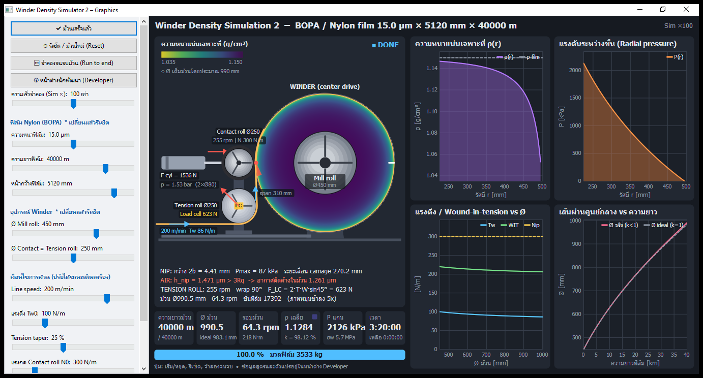
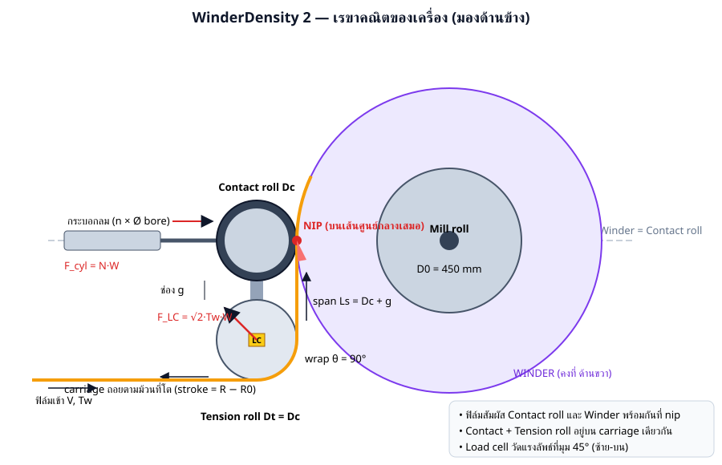
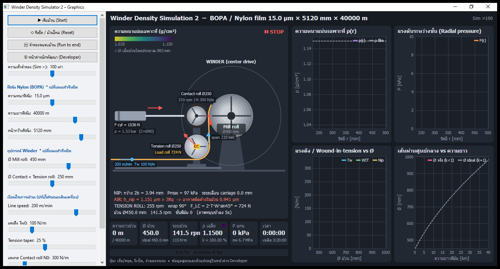
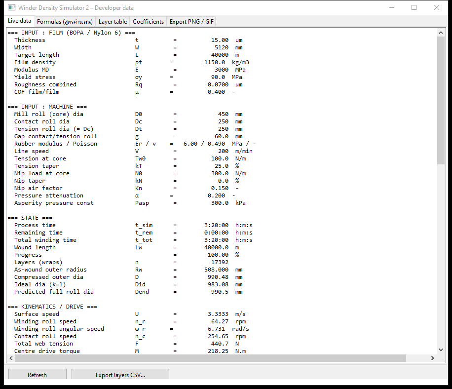
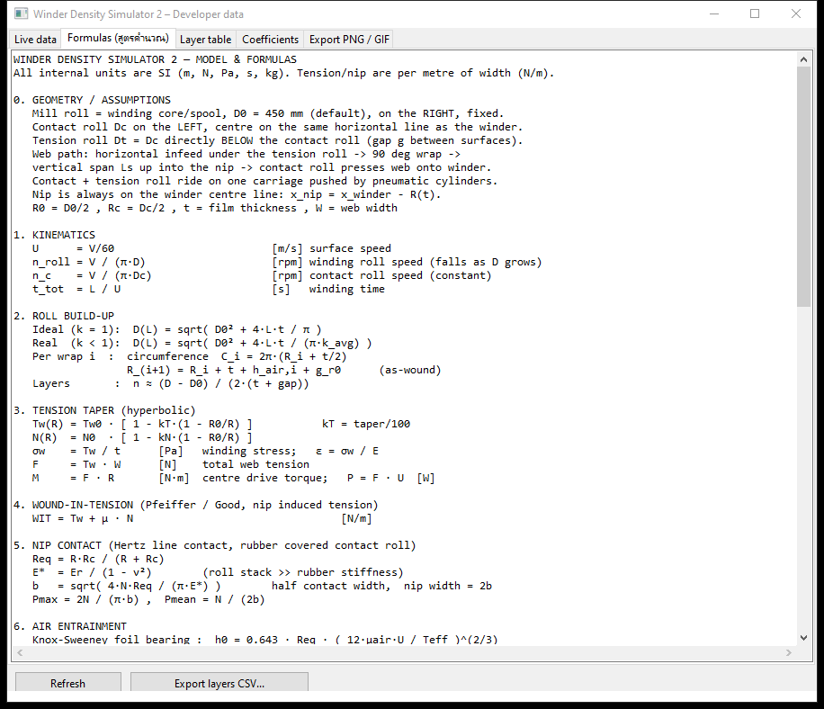
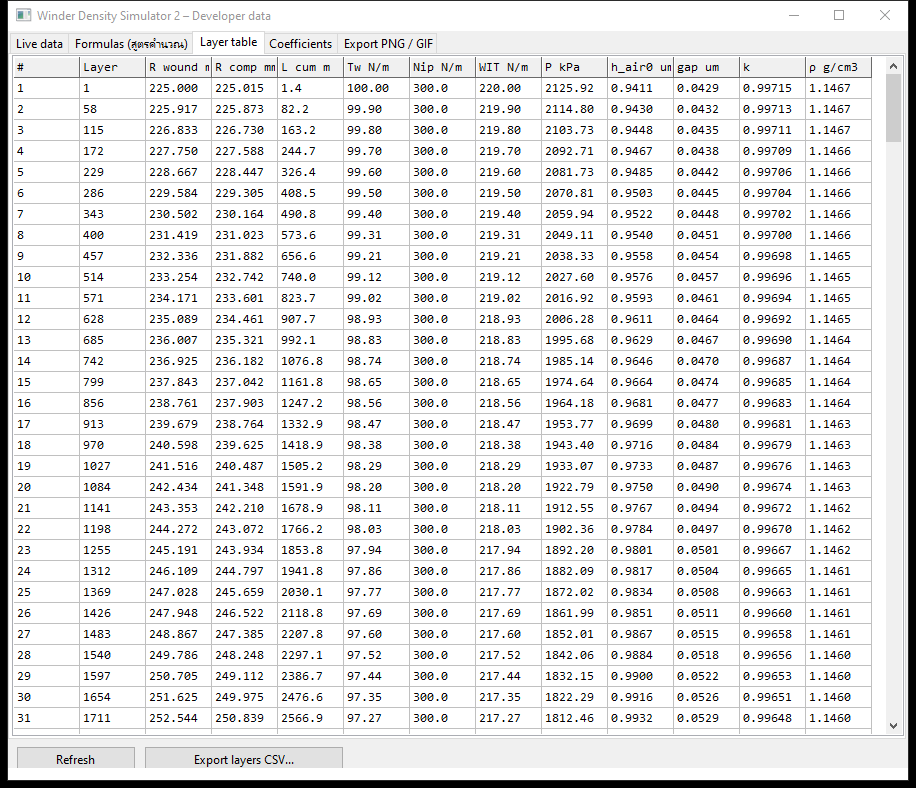
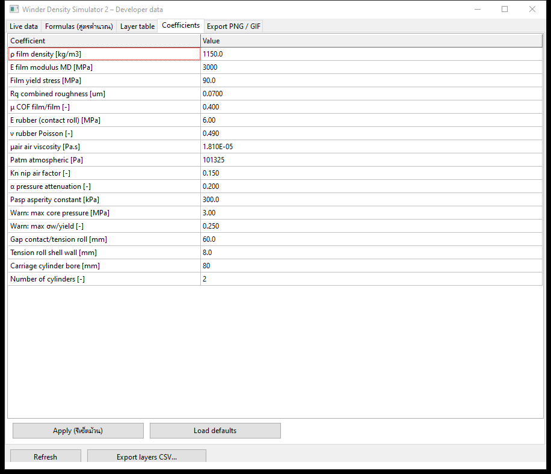
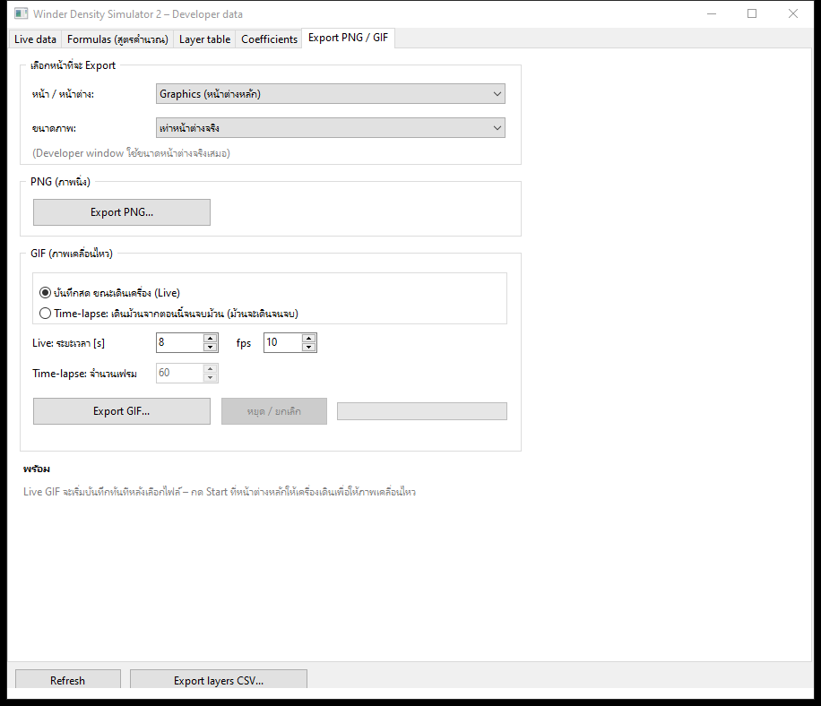
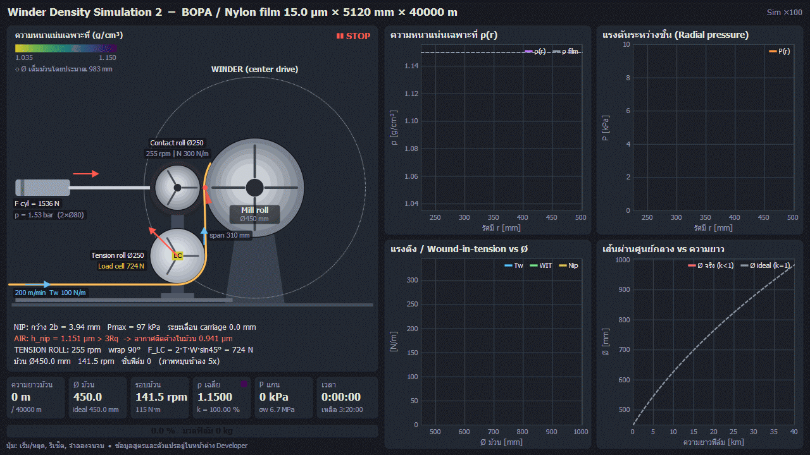
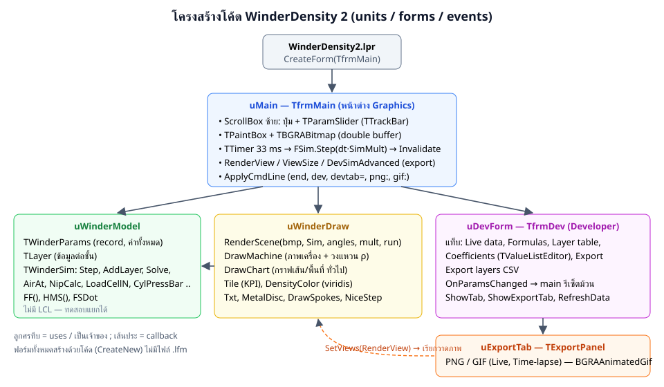

# WinderDensity 2 — เอกสารสำหรับนักพัฒนา

โปรแกรมจำลองความหนาแน่น (Density) ของม้วนฟิล์ม Nylon (BOPA) บนเครื่อง Winder ที่มี **Winder ด้านขวา**,
**Contact roll ด้านซ้ายบนเส้นศูนย์กลางเดียวกับ Winder** และ **Tension roll (load cell) อยู่ใต้ Contact roll** ขนาดเท่ากัน
ฟิล์มร้อยผ่าน Tension roll ก่อนเข้าม้วน โดย Contact roll กดฟิล์มให้แนบกับ Winder (Contact + Tension roll อยู่บน carriage เดียวกันที่ใช้กระบอกลมดัน)

เขียนด้วย **Lazarus / Free Pascal + BGRABitmap** แยกหน้าต่าง Graphics และหน้าต่างข้อมูลสำหรับนักพัฒนา

> เอกสารอยู่ใน `WinderDensitySim2\docs\` — รูปอยู่ใน `docs\images\`
> โปรแกรมพี่น้อง: [WinderDensity 1](../../WinderDensitySim/docs/README.md) (Contact roll เอียง −40°, idler),
> [WinderDensity 3](../../WinderDensitySim3/docs/README.md) (Linear motor + Servo + Cross/Top view + Manual Panel)



---

## สารบัญ

1. [ภาพรวม](#1-ภาพรวม)
2. [Build และ Run](#2-build-และ-run)
3. [เรขาคณิตของเครื่อง](#3-เรขาคณิตของเครื่อง)
4. [หน้าต่าง Graphics](#4-หน้าต่าง-graphics)
5. [หน้าต่าง Developer](#5-หน้าต่าง-developer)
6. [Export PNG / GIF](#6-export-png--gif)
7. [แบบจำลองทางฟิสิกส์และสูตรคำนวณ](#7-แบบจำลองทางฟิสิกส์และสูตรคำนวณ)
8. [พารามิเตอร์ทั้งหมด](#8-พารามิเตอร์ทั้งหมด)
9. [คำเตือน (Warnings)](#9-คำเตือน-warnings)
10. [ผลลัพธ์อ้างอิง](#10-ผลลัพธ์อ้างอิง)
11. [โครงสร้างโค้ด](#11-โครงสร้างโค้ด)
12. [วิธีเพิ่ม/แก้ไขความสามารถ](#12-วิธีเพิ่มแก้ไขความสามารถ)
13. [ข้อจำกัดและแนวทางพัฒนาต่อ](#13-ข้อจำกัดและแนวทางพัฒนาต่อ)
14. [ประวัติการเปลี่ยนแปลง](#14-ประวัติการเปลี่ยนแปลง)

---

## 1. ภาพรวม

| หัวข้อ | รายละเอียด |
|---|---|
| วัตถุประสงค์ | จำลองการม้วนฟิล์มทีละชั้น คำนวณ ρ(r), P(r), Ø ม้วน, อากาศในม้วน + แรง load cell, กระบอกลม, ระยะเลื่อน carriage |
| ฟิล์ม | Nylon / BOPA หนา 10–25 µm, ยาว 25,000–50,000 m, หน้ากว้างค่าตั้งต้น 5120 mm |
| ความเร็วไลน์ | 120–250 m/min |
| อุปกรณ์ | Winder (center drive, ขวา), Mill roll Ø450 mm, Contact roll Ø250 mm (ซ้าย, เส้นศูนย์กลางเดียวกัน), Tension roll Ø250 mm (ใต้ Contact roll, มี load cell), carriage + กระบอกลม 2 ตัว |
| ภาษา / Library | Free Pascal (`{$mode objfpc}`), LCL, **BGRABitmap**, BGRAAnimatedGif |
| หน้าต่าง | **Graphics** และ **Developer data** (แยกหน้าต่าง) |
| ขนาดโค้ด | 7 ไฟล์ ~2,750 บรรทัด |

---

## 2. Build และ Run

* Lazarus + FPC 3.2.2 (ทดสอบที่ `C:\lazarus`, Win64) และแพ็กเกจ **BGRABitmapPack** (Online Package Manager)
* เปิด `WinderDensity2.lpi` แล้ว **F9** หรือ:

```bash
C:\lazarus\lazbuild.exe WinderDensity2.lpi
```

* ได้ `WinderDensity2.exe`; build mode `Debug` มี Range/Overflow checks + HeapTrc
* ปิดโปรแกรมก่อน build ไม่เช่นนั้น link ไม่ได้ (error code 5)

### Command line

| Option | ผล |
|---|---|
| `end` | จำลองจนจบม้วน |
| `dev` / `devtab=<n>` / `devexport` | เปิดหน้าต่าง Developer (แท็บ 0 Live, 1 Formulas, 2 Layer table, 3 Coefficients, 4 Export) |
| `png:<view>:<file>` | Export PNG (view 0 = Graphics, 1 = Developer) |
| `gif:<view>:<file>` | GIF Time-lapse 20 เฟรม (เดินม้วนจนจบ) |

### คีย์ลัด
Space = เริ่ม/หยุด, R = รีเซ็ต, E = จำลองจนจบ, F12 = Developer

---

## 3. เรขาคณิตของเครื่อง



| รายการ | ค่า / สูตร |
|---|---|
| Winder | คงที่ด้านขวา, จุดศูนย์กลาง (0, 0) |
| Contact roll | ซ้ายของ Winder บนเส้นศูนย์กลางเดียวกัน: x = −(R + Rc) |
| Tension roll | ใต้ Contact roll, Dt = Dc, ระยะห่างผิว g (ค่าตั้งต้น 60 mm): y = 2Rc + g |
| เส้นทางฟิล์ม | เข้าแนวนอนใต้ Tension roll → พัน **90°** → ขึ้นแนวดิ่ง (span Ls = Dc + g) → **nip** ที่ x = −R บนเส้นศูนย์กลาง |
| nip | ฟิล์มแตะ Contact roll และ Winder พร้อมกัน (เส้นแนวดิ่งสัมผัสทั้งสอง roll) |
| carriage | Contact + Tension roll เลื่อนไปทางซ้ายพร้อมกันเมื่อม้วนโต, stroke = R − R0 |
| ทิศหมุน | Winder ตามเข็ม, Contact/Tension roll ทวนเข็ม (ภาพช้าลง 5 เท่า) |

---

## 4. หน้าต่าง Graphics

| ตอนเริ่ม | ตอนม้วนเสร็จ |
|---|---|
|  |  |

### ส่วนประกอบของภาพ (`DrawMachine` ใน `uwinderdraw.pas`)

| ส่วน | รายละเอียด |
|---|---|
| ภาพเครื่อง | พื้น + ขาตั้ง Winder, ม้วนเป็นวงแหวนสีตามความหนาแน่น, วงประ = Ø ม้วนเต็มโดยประมาณ |
| Carriage | แผ่นตั้งเชื่อม Contact + Tension roll, รางบนพื้น, กระบอกลมด้านซ้าย (แสดง F_cyl และ p bar) |
| Tension roll | สีโครเมียม, กล่อง **LC** (load cell) + ลูกศรแรงลัพธ์ 45°, ค่า Load cell |
| ฟิล์ม | เส้นส้ม: แนวนอน → พัน 90° → แนวดิ่ง (ป้าย span) → พันบน Winder |
| nip | จุดแดง + ลิ่มอากาศใต้ nip (แดง = ติดค้าง / ฟ้า = ระบายได้) |
| ข้อความใต้ภาพ | NIP 2b, Pmax, ระยะเลื่อน carriage / AIR / TENSION ROLL rpm, wrap 90°, F_LC / Ø, rpm, ชั้น |
| KPI + Progress | เหมือน Program 1 |
| กราฟ 4 รูป | ρ(r), P(r), Tw/WIT/Nip vs Ø, Ø vs ความยาว |

### แถบควบคุม

| Slider | ช่วง | ขั้น | ค่าตั้งต้น | รีเซ็ตม้วน |
|---|---|---|---|---|
| ความเร็วจำลอง | 1–10,000× (log) | — | 100 | ไม่ |
| ความหนาฟิล์ม | 10–25 µm | 0.5 | 15 | ใช่ |
| ความยาวฟิล์ม | 25,000–50,000 m | 500 | 40,000 | ใช่ |
| หน้ากว้างฟิล์ม | 500–6,000 mm | 10 | 5,120 | ใช่ |
| Ø Mill roll | 300–600 mm | 10 | 450 | ใช่ |
| Ø Contact = Tension roll | 150–400 mm | 10 | 250 | ใช่ |
| Line speed | 120–250 m/min | 1 | 200 | ไม่ |
| แรงตึง Tw0 | 30–300 N/m | 5 | 100 | ไม่ |
| Tension taper | 0–60 % | 1 | 25 | ไม่ |
| แรงกด N0 | 50–1,500 N/m | 10 | 300 | ไม่ |
| Nip taper | 0–60 % | 1 | 0 | ไม่ |

---

## 5. หน้าต่าง Developer

| แท็บ | รายละเอียด | ภาพ |
|---|---|---|
| Live data | ทุกค่า รวมส่วน **TENSION ROLL / LOAD CELL / WEB SPAN** และ **CONTACT ROLL CARRIAGE / CYLINDER** |  |
| Formulas | สูตรทั้งหมด (หัวข้อ 7) |  |
| Layer table | ตารางรายชั้น ≤ 300 แถว |  |
| Coefficients | ค่าคงที่ + ระยะห่าง roll, ผนัง Tension roll, ขนาด/จำนวนกระบอกลม |  |
| Export PNG / GIF | หัวข้อ 6 |  |

**Export layers CSV**: `layer, R_wound_mm, R_comp_mm, L_cum_m, Tw_N_m, Nip_N_m, WIT_N_m, P_kPa, h_air0_um, gap_um, k, rho_g_cm3`

---

## 6. Export PNG / GIF

`uExportTab.TExportPanel` (ไฟล์เดียวกับ Program 1 และ 3)

* หน้า: `Graphics (หน้าต่างหลัก)` หรือ `Developer window (หน้านี้)`
* ขนาด: เท่าหน้าต่างจริง / 960×540 / 1280×720 / 1600×900 / 1920×1080
* PNG ภาพนิ่ง; GIF **Live** (1–120 s, 1–25 fps) หรือ **Time-lapse** (5–300 เฟรม เดินม้วนจนจบ)



(ไฟล์ [timelapse.gif](images/timelapse.gif) 20 เฟรม 1280×720 ~4.4 MB)

---

## 7. แบบจำลองทางฟิสิกส์และสูตรคำนวณ


หน่วยภายในเป็น SI; แรงตึง/แรงกดคิดต่อความกว้าง 1 m (N/m)

### 7.1 Kinematics
```
U = V/60 ; n_roll = V/(π·D) ; n_c = n_t = V/(π·Dc) ; t_total = L/U
```

### 7.2 การโตของม้วน
```
Ideal : D(L) = √(D0² + 4·L·t/π)
Real  : D(L) = √(D0² + 4·L·t/(π·k_avg))
ชั้น i : C_i = 2π(R_i + t/2) ; R_(i+1) = R_i + t + h_air,i + g_r0
```

### 7.3 Tension taper
```
Tw(R) = Tw0·[1 − kT·(1 − R0/R)] ; N(R) = N0·[1 − kN·(1 − R0/R)]
σw = Tw/t ; ε = σw/E ; F = Tw·W ; M = F·R ; P = F·U
```

### 7.4 Wound-in-tension
```
WIT = Tw + μ·N
```

### 7.5 Nip (Hertz line contact)
```
Req = R·Rc/(R+Rc) ; E* = Er/(1−ν²) ; b = √(4·N·Req/(π·E*))
Pmax = 2N/(π·b) ; Pmean = N/(2b)
```

### 7.6 อากาศ
```
h0 = 0.643·Req·(12·μair·U/(Tw+N))^(2/3) ; hn = Kn·h0 ; ha = max(0, hn − 3Rq)
```

### 7.7 แรงดันระหว่างชั้น
```
P_i = α · Σ_(j>i) WIT_j / (R_j + t/2)
```

### 7.8 การบีบช่องว่าง
```
gap_i = ha·Patm/(Patm + P_i) + 2Rq·exp(−P_i/Pasp)
```

### 7.9 ความหนาแน่น
```
k_i = t/(t + gap_i) ; ρ_i = k_i·ρf
Rc_i = √(R0² + Σ_(j≤i) ℓ_j·(t + gap_j)/π)      (area conservation)
k_avg = L·t/(π·(Rout² − R0²)) ; ρ_avg = k_avg·ρf ; m = ρf·t·W·L
```

### 7.10 Tension roll / Load cell (เฉพาะ Program 2)
```
มุมพัน           θ   = 90°   (เข้าแนวนอน ออกแนวดิ่ง)
แรง load cell    F_LC = 2·Tw·W·sin(θ/2) = √2·Tw·W      ทิศ 45° ซ้าย-บน
ต่อข้าง (2 ตัว)   F_LC/2
รอบ              n_t = V/(π·Dt)
มวล shell        m_t = 7850·π·(Ro² − Ri²)·(W + 0.2) ,  Ri = Ro − wall
ความเฉื่อย        J_t = m_t·(Ro² + Ri²)/2 ;  E_k = J_t·ω²/2
Span อิสระ       Ls = Dc + g ;  ε = Tw/(E·t) ;  τ = Ls/U
```

### 7.11 Carriage / กระบอกลม (เฉพาะ Program 2)
```
F_cyl = N·W
p_cyl = F_cyl / (n·π·d²/4)            [Pa] → /1e5 = bar
stroke = R(t) − R0
v_c   = dR/dt = t·U/(2π·R·k)          ความเร็วถอยของ carriage
```

### 7.12 ค่าวัสดุ BOPA ทั่วไป
ρf 1.14–1.16 g/cm³, E(MD) 2–4 GPa, σy 60–100 MPa, μ 0.3–0.6, winding stress 4–12 MPa, ยาง 60–80 Shore A (Er ≈ 4–9 MPa)

---

## 8. พารามิเตอร์ทั้งหมด

`TWinderParams` ใน `uwindermodel.pas` (ค่าตั้งต้น `SetDefaults`)

| Field | ความหมาย | หน่วย | ค่าตั้งต้น | แก้ที่ |
|---|---|---|---|---|
| ThickUm | ความหนาฟิล์ม | µm | 15 | Slider |
| WidthMm | หน้ากว้าง | mm | 5120 | Slider |
| LengthM | ความยาว | m | 40000 | Slider |
| RhoFilm | ความหนาแน่นฟิล์ม | kg/m³ | 1150 | Coefficients |
| EFilmMPa | Modulus MD | MPa | 3000 | Coefficients |
| YieldMPa | Yield | MPa | 90 | Coefficients |
| RqUm | ความขรุขระรวม | µm | 0.07 | Coefficients |
| COF | μ ฟิล์ม/ฟิล์ม | – | 0.40 | Coefficients |
| CoreDiaMm | Ø Mill roll | mm | 450 | Slider |
| ContactDiaMm | Ø Contact = Tension roll | mm | 250 | Slider |
| **RollGapMm** | ระยะห่างผิว Contact ↔ Tension roll | mm | 60 | Coefficients |
| **TRollWallMm** | ความหนาผนัง Tension roll | mm | 8 | Coefficients |
| **CylBoreMm** | Ø กระบอกลม | mm | 80 | Coefficients |
| **CylCount** | จำนวนกระบอกลม | – | 2 | Coefficients |
| RubberEMPa / RubberNu | ยาง Contact roll | MPa / – | 6 / 0.49 | Coefficients |
| SpeedMpm | ความเร็วไลน์ | m/min | 200 | Slider |
| TensionNm / TaperPct | แรงตึง / taper | N/m / % | 100 / 25 | Slider |
| NipNm / NipTaperPct | แรงกด / taper | N/m / % | 300 / 0 | Slider |
| AirVisc / Patm | อากาศ | Pa·s / Pa | 1.81e-5 / 101325 | Coefficients |
| NipAirFactor (Kn) | | – | 0.15 | Coefficients |
| PressAtten (α) | | – | 0.20 | Coefficients |
| AspPressKPa (Pasp) | | kPa | 300 | Coefficients |
| MaxCorePressMPa / MaxStressRatio | เกณฑ์เตือน | MPa / – | 3.0 / 0.25 | Coefficients |

---

## 9. คำเตือน (Warnings)

| Tag | เงื่อนไข |
|---|---|
| `[AIR]` | hn > 3Rq (อากาศติดค้าง) |
| `[TENSION]` | σw > MaxStressRatio·σy |
| `[CORE]` | P_core > MaxCorePressMPa |
| `[SOFT]` | k_outer < 0.95 |
| `[TAPER]` | Tw < 30% Tw0 |
| `[NIP]` | Pmax > 1 MPa |
| `[CYL]` | p_cyl > 6 bar (ลมโรงงานไม่พอ → ใช้กระบอกใหญ่ขึ้น) |

---

## 10. ผลลัพธ์อ้างอิง

ค่าตั้งต้น 15 µm × 5120 mm × 40,000 m, 200 m/min, Tw0 100 N/m (taper 25%), N0 300 N/m

| ค่า | ผล |
|---|---|
| Ø ม้วนเต็ม | 990.5 mm (ideal 983.1 mm) |
| k_avg / ρ_avg | 98.12 % / 1.1284 g/cm³ |
| P ที่แกน | 2,126 kPa |
| มวลฟิล์ม / เวลา | 3,533 kg / 3:20:00 |
| Load cell | 724 N ตอนเริ่ม (Tw 100) → 623 N ตอนจบ (Tw 86) |
| แรงกระบอกลม | 1,536 N → 1.53 bar (2 × Ø80) |
| ระยะเลื่อน carriage ตอนจบ | 270.2 mm |
| Span Tension roll → nip | 310 mm, τ ≈ 93 ms |
| Tension roll | 255 rpm, shell ≈ 254 kg, J ≈ 3.72 kg·m² |
| Nip ตอนจบ | 2b = 4.41 mm, Pmax = 87 kPa |
| อากาศตอนจบ | hn = 1.471 µm → ติดค้าง 1.261 µm |

---

## 11. โครงสร้างโค้ด



| ไฟล์ | บรรทัด | หน้าที่ |
|---|---|---|
| `WinderDensity2.lpr` | 20 | program |
| `WinderDensity2.lpi` | 121 | project (BGRABitmapPack, LCL; Default + Debug) |
| `uwindermodel.pas` | 615 | แบบจำลอง + Tension roll/Load cell/Cylinder |
| `uwinderdraw.pas` | 560 | `RenderScene`, `DrawMachine` (layout Program 2), `Arrow`, `Badge` |
| `umain.pas` | ~460 | หน้าต่าง Graphics |
| `udevform.pas` | ~615 | หน้าต่าง Developer |
| `uexporttab.pas` | 408 | Export PNG/GIF |

### ฟังก์ชันที่เพิ่มจาก Program 1 (`TWinderSim`)

| ฟังก์ชัน | สูตร |
|---|---|
| `RTension` | = RContact |
| `WrapRad` | π/2 |
| `SpanM` | 2·Rc + g |
| `LoadCellN` | 2·Tw·W·sin(θ/2) |
| `TRollRpm` | V/(π·Dt) |
| `TRollMassKg`, `TRollInertia` | shell เหล็ก 7850 kg/m³, ยาว W + 0.2 m |
| `SpanStrain`, `SpanTimeConst` | Tw/(E·t), Ls/U |
| `CylForceN`, `CylPressBar` | N·W, F/(n·πd²/4)/1e5 |
| `CarriageStrokeMm` | (Rout − R0)·1000 |

### ลำดับการทำงาน
เหมือน Program 1: `TTimer 33 ms → Step(dt·SimMult) → AddLayer/Solve → RenderScene → Draw` และ Developer อัปเดตทุก 15 tick

### ข้อควรระวัง
* ฟอร์มสร้างด้วยโค้ด (`CreateNew`) ไม่มี `.lfm`
* `with Layers[i] do` ทำให้ `r`, `P` ชี้ field ของชั้น — ใช้ชื่ออื่น (`rr`, `patm`) หรือ `Self.P`
* UTF-8 ไม่มี BOM, ไม่ใส่ `{$codepage utf8}`; ใช้ `FF()`/`FSDot` กับตัวเลข
* PowerShell alias `R` = Invoke-History (ถ้าเขียนสคริปต์แก้โค้ดอัตโนมัติ อย่าตั้งชื่อฟังก์ชัน `R`)

---

## 12. วิธีเพิ่ม/แก้ไขความสามารถ

* **พารามิเตอร์ใหม่**: field ใน `TWinderParams` → `SetDefaults` → (slider ใน `TfrmMain.Create` + `SimToSliders`/`ParamsToSim`) หรือ (`KEY_` + `LoadCoefs` + `BtnApplyClick` ใน `udevform.pas`) → แสดงใน `FillLive` + สูตรใน `FillFormulas`
* **มุมพันไม่ใช่ 90°**: แก้ `WrapRad` และเส้นทางฟิล์มใน `DrawMachine` (ดู Program 3 ที่คำนวณเส้นสัมผัสทั่วไปด้วย `Tangent`)
* **กราฟใหม่**: `TSeries` + `DrawChart` ใน `RenderScene`
* **คำเตือนใหม่**: `GetWarnings`
* **หน้า Export ใหม่**: `SetViews` + `RenderView`/`ViewSize`

---

## 13. ข้อจำกัดและแนวทางพัฒนาต่อ

**ข้อจำกัด**: Kn, α, Pasp ต้องปรับเทียบกับม้วนจริง; แรงดันแบบ thin-ring × α; มุมพัน Tension roll ตายตัว 90°; carriage เคลื่อนตาม R ทันที (ไม่มี dynamics ของกระบอกลม); แรง load cell คำนวณแบบ static (ไม่มีแรงเฉื่อย/แรงเสียดทาน bearing)

**แนวทาง**: ปรับเทียบจากข้อมูลจริง, Hakiel model, dynamics ของกระบอกลม (ปริมาตร/วาล์ว/แรงเสียดทาน), tension control loop จาก load cell (PID → แรงบิด winder), ต่อยอดเป็น Program 3 (servo/linear motor)

---

## 14. ประวัติการเปลี่ยนแปลง

| ครั้ง | รายการ |
|---|---|
| 1 | สร้างจาก Program 1: layout ใหม่, Tension roll + load cell, carriage + กระบอกลม |
| 2 | หน้ากว้างค่าตั้งต้น 5120 mm, slider 500–6000 mm |
| 3 | แท็บ Export PNG / GIF |
| 4 | Command line options + เอกสารนี้ |
