# WinderDensity 3 — เอกสารสำหรับนักพัฒนา

โปรแกรมจำลองความหนาแน่น (Density) ของม้วนฟิล์ม Nylon (BOPA) บนเครื่อง Winder ที่มี

* **Winder ด้านขวา** (Mill roll Ø450 mm, center drive)
* **Contact roll ด้านซ้าย** บนเส้นศูนย์กลางเดียวกับ Winder — ขับด้วย **Linear motor** เดินหน้า (กดฟิล์ม, ควบคุมแรงกด) / ถอยหลัง
* **Tension roll ใต้ Contact roll** ขนาดเท่ากัน — ขับด้วย **Servo motor + ball screw** เดินหน้า/ถอยหลัง และ **ล้ำหน้า Contact roll ได้** เพื่อปรับองศาฟิล์ม
* ฟิล์มร้อยผ่าน Tension roll ก่อนเข้าม้วน โดย Contact roll กดฟิล์มให้แนบกับ Winder

หน้าต่าง: **Graphics**, **Developer data**, **Cross view (ภาพแนวขวาง)**, **Top View (มองจากด้านบน)**, **Manual Panel** — ทุกหน้าต่างแยกกัน
เขียนด้วย **Lazarus / Free Pascal + BGRABitmap**

> เอกสารอยู่ใน `WinderDensitySim3\docs\` — รูปอยู่ใน `docs\images\`
> โปรแกรมพี่น้อง: [WinderDensity 1](../../WinderDensitySim/docs/README.md), [WinderDensity 2](../../WinderDensitySim2/docs/README.md)

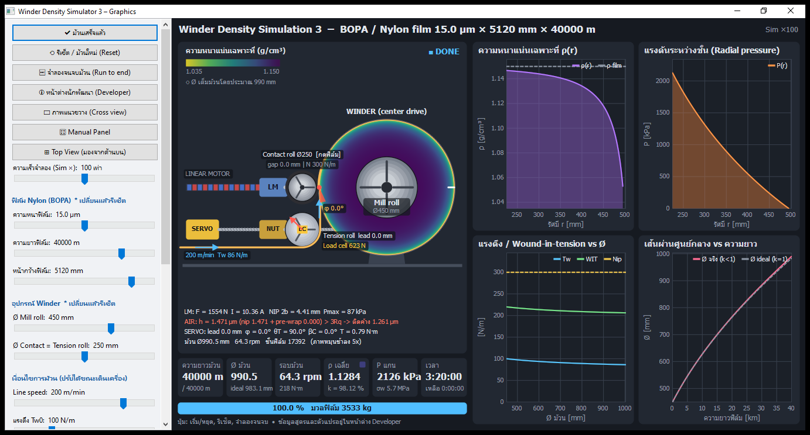

---

## สารบัญ

1. [ภาพรวม](#1-ภาพรวม)
2. [Build และ Run](#2-build-และ-run)
3. [เรขาคณิตและเส้นทางฟิล์ม](#3-เรขาคณิตและเส้นทางฟิล์ม)
4. [หน้าต่าง Graphics](#4-หน้าต่าง-graphics)
5. [หน้าต่าง Cross view (ภาพแนวขวาง)](#5-หน้าต่าง-cross-view-ภาพแนวขวาง)
6. [หน้าต่าง Top View](#6-หน้าต่าง-top-view)
7. [หน้าต่าง Manual Panel](#7-หน้าต่าง-manual-panel)
8. [หน้าต่าง Developer](#8-หน้าต่าง-developer)
9. [Export PNG / GIF](#9-export-png--gif)
10. [แบบจำลองทางฟิสิกส์และสูตรคำนวณ](#10-แบบจำลองทางฟิสิกส์และสูตรคำนวณ)
11. [พารามิเตอร์ทั้งหมด](#11-พารามิเตอร์ทั้งหมด)
12. [คำเตือน (Warnings)](#12-คำเตือน-warnings)
13. [ผลลัพธ์อ้างอิง](#13-ผลลัพธ์อ้างอิง)
14. [โครงสร้างโค้ด](#14-โครงสร้างโค้ด)
15. [วิธีเพิ่ม/แก้ไขความสามารถ](#15-วิธีเพิ่มแก้ไขความสามารถ)
16. [ข้อจำกัดและแนวทางพัฒนาต่อ](#16-ข้อจำกัดและแนวทางพัฒนาต่อ)
17. [ประวัติการเปลี่ยนแปลง](#17-ประวัติการเปลี่ยนแปลง)

---

## 1. ภาพรวม

| หัวข้อ | รายละเอียด |
|---|---|
| วัตถุประสงค์ | จำลองการม้วนรายชั้น: ρ(r), P(r), Ø, อากาศ + ผลของตำแหน่ง Tension roll (มุมฟิล์ม, pre-wrap), การกด/ถอย Contact roll, แรงกดตามหน้ากว้าง (การแอ่นตัว + crown), แรง/กระแส/แรงบิดของมอเตอร์ |
| ฟิล์ม | Nylon / BOPA 10–25 µm, 25,000–50,000 m, หน้ากว้างค่าตั้งต้น 5120 mm |
| ความเร็วไลน์ | 120–250 m/min |
| แกนขับ | Linear motor (Contact roll), Servo + ball screw ×2 (Tension roll, OS/DS) |
| หน้าต่าง | 5 หน้าต่าง (Graphics, Developer, Cross view, Top View, Manual Panel) |
| ขนาดโค้ด | 10 ไฟล์ ~4,600 บรรทัด |

---

## 2. Build และ Run

* Lazarus + FPC 3.2.2 (`C:\lazarus`, Win64) และแพ็กเกจ **BGRABitmapPack**
* เปิด `WinderDensity3.lpi` แล้ว **F9** หรือ:

```bash
C:\lazarus\lazbuild.exe WinderDensity3.lpi
```

* ได้ `WinderDensity3.exe`; build mode `Debug` มี checks + HeapTrc
* ปิดโปรแกรมก่อน build (ไม่เช่นนั้น link error code 5)

### คีย์ลัด

| คีย์ | ผล |
|---|---|
| Space | เริ่ม / หยุด |
| R | รีเซ็ต (ล้าง E-STOP ด้วย) |
| E | จำลองจนจบม้วน |
| F9 | Top View |
| F10 | Cross view |
| F11 | Manual Panel |
| F12 | Developer |

### Command line (ทดสอบอัตโนมัติ / ทำภาพเอกสาร)

| Option | ผล |
|---|---|
| `lead=<mm>` | ตั้ง lead ของ Tension roll (ขยับแกนทันที) |
| `retract` | ถอย Contact roll (ตั้ง gap ทันที) |
| `end` | จำลองจนจบม้วน |
| `dev`, `devtab=<n>`, `devexport` | หน้าต่าง Developer (แท็บ 0–4) |
| `cross`, `top`, `panel` | เปิด Cross view / Top View / Manual Panel |
| `png:<view>:<file>` | Export PNG (0 Graphics, 1 Cross, 2 Top, 3 Panel, 4 Developer) |
| `gif:<view>:<file>` | GIF Time-lapse 20 เฟรม |

ตัวอย่าง (option ทำงานตามลำดับ):

```bash
WinderDensity3.exe lead=80 end top
```

---

## 3. เรขาคณิตและเส้นทางฟิล์ม

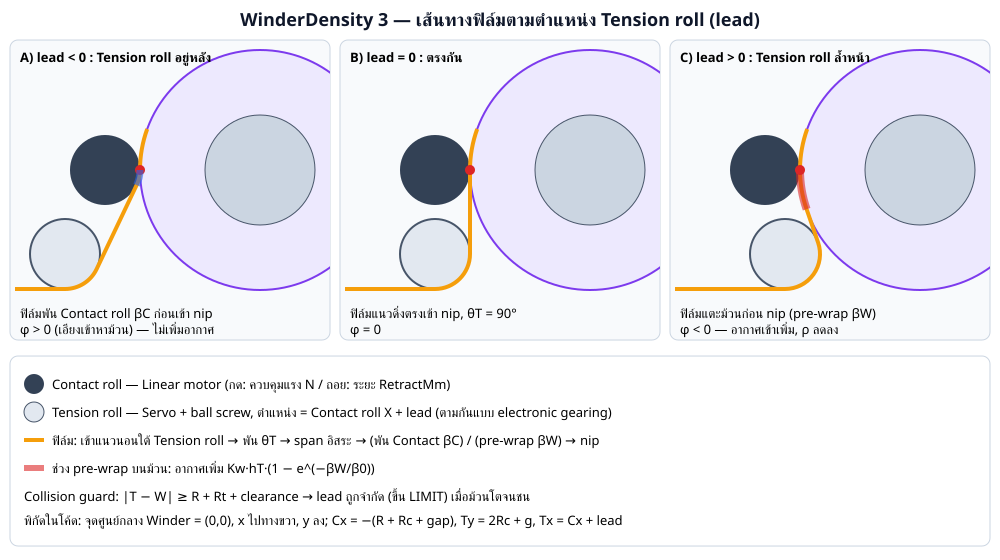

### ระบบพิกัด (ในโค้ด)

จุดศูนย์กลาง Winder = (0, 0), x ไปทางขวา, **y ลง** (เหมือนหน้าจอ)

```
Contact roll : Cx = −(R + Rc + gap) , Cy = 0
Tension roll : Ty = 2·Rc + g ,  Tx = Cx + lead
nip          : (−R, 0)
```

* **gap** = ระยะถอยของ Contact roll จากผิวม้วน (0 เมื่อกด)
* **lead** = ระยะที่ Tension roll ล้ำหน้า Contact roll (+ = ไปทางม้วน)
* **Collision guard**: |T| ≥ R + Rt + clearance → `lead_max = −√((R+Rt+clr)² − Ty²) − Cx` ถ้าเกิน แกน servo ถูกจำกัด (ขึ้น LIMIT)

### เส้นสัมผัสระหว่าง roll (`Tangent` ใน `uwindermodel.pas`)

ฟิล์มวิ่งจาก roll 1 ไป roll 2; side = +1 ถ้าจุดศูนย์กลางอยู่ **ซ้าย** ของทิศฟิล์ม (พันทวนเข็มบนจอ), −1 ถ้าอยู่ขวา

```
D = P2 − P1 ,  h = r1·s1 − r2·s2
angle(d) = atan2(Dy, Dx) − asin(h/|D|) ,  n = (−dy, dx)
Q1 = P1 + r1·s1·n ,  Q2 = P2 + r2·s2·n        (จุดสัมผัส)
```

### ประเภทเส้นทาง (`TGeo.PathType`)

| Type | เงื่อนไข | เส้นทาง | ผล |
|---|---|---|---|
| 1 | กด, lead ≤ 0 | T → พัน Contact roll βC → nip | ไม่เพิ่มอากาศ |
| 2 | กด, lead > 0 | T → แตะ Winder ก่อน nip (pre-wrap βW) → nip | อากาศเพิ่ม |
| 3 | ถอย | T → Winder (ไม่มี nip) | อากาศมาก |
| 4 | ถอย และเส้นตรงชน Contact roll | T → พัน Contact roll → Winder | อากาศมาก |

มุมที่คำนวณ: φ (มุมฟิล์มจากแนวดิ่ง, + = เอียงเข้าหาม้วน), θT (พัน Tension roll), βC (พัน Contact roll), βW (pre-wrap บน Winder)

---

## 4. หน้าต่าง Graphics

| lead = −80 mm (พัน Contact roll) | lead = +80 mm (pre-wrap, ถูกจำกัด 70.6) |
|---|---|
| 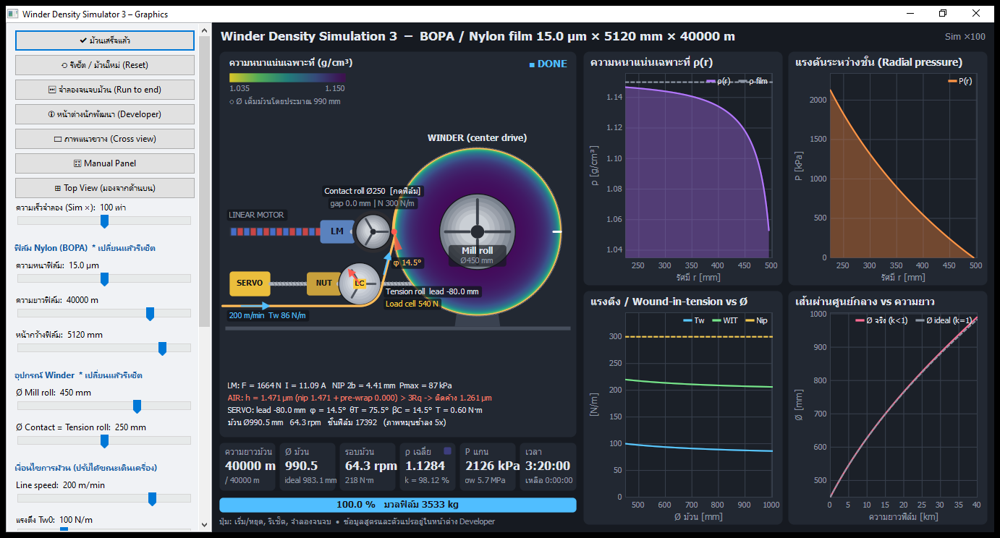 | 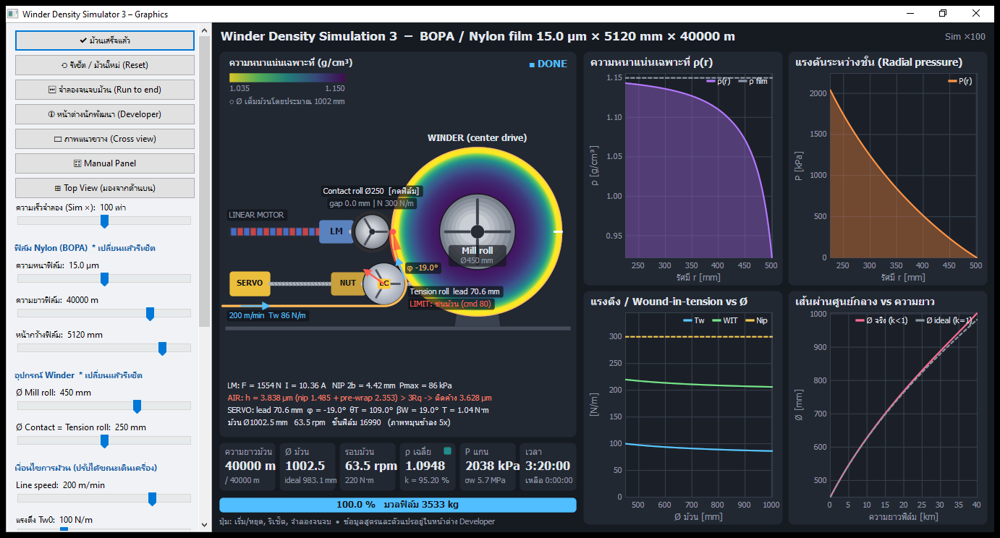 |

| lead = 0 | Contact roll ถอย (ไม่มี nip) |
|---|---|
|  | 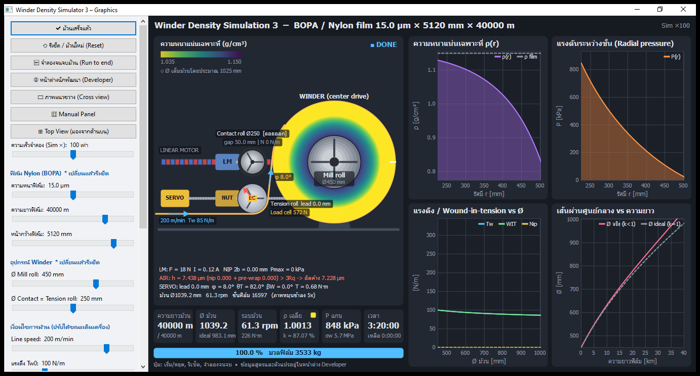 |

### ส่วนประกอบของภาพ (`DrawMachine` ใน `uwinderdraw.pas`)

| ส่วน | รายละเอียด |
|---|---|
| Linear motor | รางแม่เหล็ก (แดง/น้ำเงิน) + forcer **LM**, ลูกศรเขียวเมื่อแกนเคลื่อนที่ |
| Servo | มอเตอร์ **SERVO** + ball screw + **NUT**, ลูกศรเขียวเมื่อเคลื่อนที่ |
| ม้วน | วงแหวนสีความหนาแน่น, วงประ = Ø ม้วนเต็ม, เส้นแดงหนา = ช่วง pre-wrap |
| ฟิล์ม | เส้นทางคำนวณจริงตาม `Geo`, ป้าย φ ที่ span, ลูกศรทิศฟิล์ม |
| ป้าย | Contact roll [กดฟิล์ม/ถอยออก] gap/N, Tension roll lead, Load cell หรือ LIMIT |
| ข้อความ 4 บรรทัด | LM: F, I, NIP 2b, Pmax / AIR: h (nip + pre-wrap) / SERVO: lead, φ, θT, βC หรือ βW, แรงบิด / ม้วน Ø, rpm, ชั้น |
| KPI + กราฟ | เหมือน Program 1–2 |

### แถบควบคุมและปุ่ม

| ควบคุม | ช่วง | ค่าตั้งต้น | หมายเหตุ |
|---|---|---|---|
| Sim × | 1–10,000 (log) | 100 | |
| ความหนา / ความยาว / หน้ากว้าง | 10–25 µm / 25–50 km / 500–6000 mm | 15 / 40,000 / 5,120 | รีเซ็ตม้วน |
| Ø Mill roll / Ø Contact = Tension | 300–600 / 150–400 mm | 450 / 250 | รีเซ็ตม้วน |
| Line speed, Tw0, taper | 120–250 m/min, 30–300 N/m, 0–60 % | 200, 100, 25 | |
| ◀ ถอยหลัง (Retract) / เดินหน้า กด ▶ (Press) | — | Press | ปุ่มที่ใช้งานเป็นตัวหนา |
| แรงกดฟิล์ม N0, Nip taper | 50–1500 N/m, 0–60 % | 300, 0 | |
| ระยะถอย | 10–150 mm (ขั้น 5) | 50 | |
| ◀ ถอย 10 mm / ล้ำหน้า 10 mm ▶ | jog ทีละ 10 mm | | ขยับ slider lead |
| ระยะล้ำหน้า Contact roll (lead) | −150…+150 mm (ขั้น 5) | 0 | |
| ปุ่มเปิดหน้าต่าง | Developer, Cross view, Manual Panel, Top View | | |

แกน LM และ Servo เคลื่อนที่ **ตามเวลาจริง** (ไม่คูณ Sim ×) ด้วย trapezoidal profile แม้ตอนหยุดม้วน

---

## 5. หน้าต่าง Cross view (ภาพแนวขวาง)

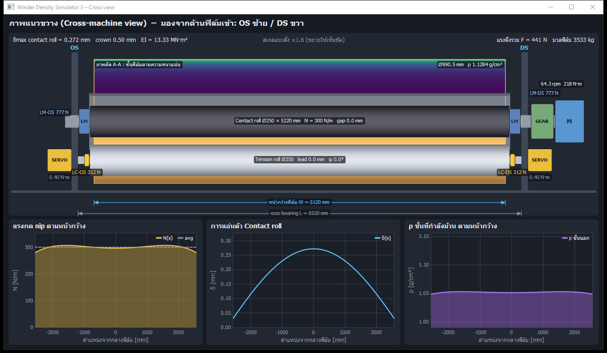

`uCrossView.TfrmCross` / `RenderCross` — มองจากด้านฟิล์มเข้า: **OS ซ้าย / DS ขวา**

| ส่วน | รายละเอียด |
|---|---|
| โครงเครื่อง | เสา OS/DS, พื้น, เพลา Winder, chuck (CH), GEAR + มอเตอร์ขับ (M) ฝั่ง DS พร้อม rpm/แรงบิด |
| ม้วน | ครึ่งบน = **ภาพตัด A-A** แสดงชั้นฟิล์มตามความหนาแน่น (120 แถบ), ครึ่งล่าง = ผิวม้วน |
| Contact roll | ด้านหน้าม้วน, LM ทั้ง 2 ข้าง (แรงข้างละ F_lm/2) |
| Tension roll | load cell 2 ข้าง (F_LC/2), Servo 2 ตัวนอกเสา (แรงบิดข้างละครึ่ง) |
| ฟิล์ม | แถบโปร่งแสงกว้าง W ระหว่าง Tension roll กับ nip |
| เส้นบอกขนาด | W = 5120 mm, ระยะ bearing L = W + 400 mm |
| สเกล | แนวนอนจริง, **แนวตั้งขยายได้ถึง 2.5×** (แสดงป้าย "สเกลแนวตั้ง ×…") |
| กราฟ 3 รูป | แรงกด nip N(u), การแอ่นตัว δ(u), ρ ชั้นที่กำลังม้วน ตามหน้ากว้าง |

---

## 6. หน้าต่าง Top View

| lead −80 (Tension roll ซ่อนใต้ Contact roll) | lead +80 (ล้ำหน้า, LIMIT) |
|---|---|
| 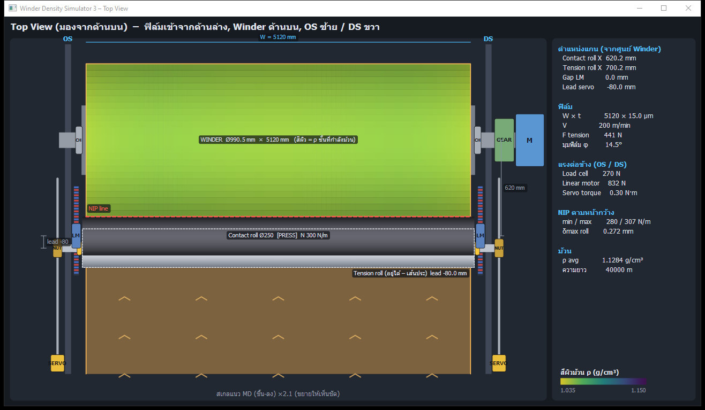 | 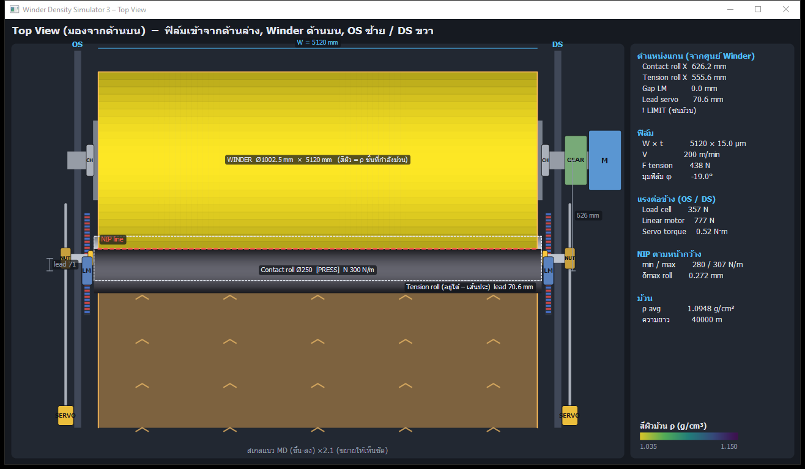 |

`uTopView.TfrmTop` / `RenderTop` — มองจากด้านบน: แนวนอน = หน้ากว้าง (OS ซ้าย/DS ขวา), แนวตั้ง = ทิศเครื่อง (ฟิล์มเข้าจากล่าง, Winder บน)

| ส่วน | รายละเอียด |
|---|---|
| ผิวม้วน | สีตาม **ρ ของชั้นที่กำลังม้วนตามหน้ากว้าง** (จาก `CDProfile`) + เงาทรงกระบอก |
| ฟิล์มเข้า | แถบกว้าง W มีลูกศร (chevron) เคลื่อนที่ตาม `Phase` (ช้าลง 5×) |
| Contact roll | บนเส้นศูนย์กลาง, LM forcer 2 ข้างบนรางแม่เหล็ก, เส้น **NIP line** สีแดงประ |
| Tension roll | อยู่ต่ำกว่า → วาดก่อน Winder/Contact roll; ส่วนที่ถูกบังเป็น **เส้นประ (hidden line)**; NUT + ball screw + SERVO นอกเสา, load cell สีเหลือง |
| เส้นบอกขนาด | W, ระยะศูนย์ Winder → Contact roll, lead |
| คอลัมน์ข้อมูล | ตำแหน่งแกน, ฟิล์ม (W×t, V, F, φ), แรงต่อข้าง, NIP min/max, δmax, ρ avg, ความยาว |
| สเกล | แนวนอนจริง, แนวทิศเครื่องขยายได้ถึง 2.5× (มีป้าย) |

---

## 7. หน้าต่าง Manual Panel

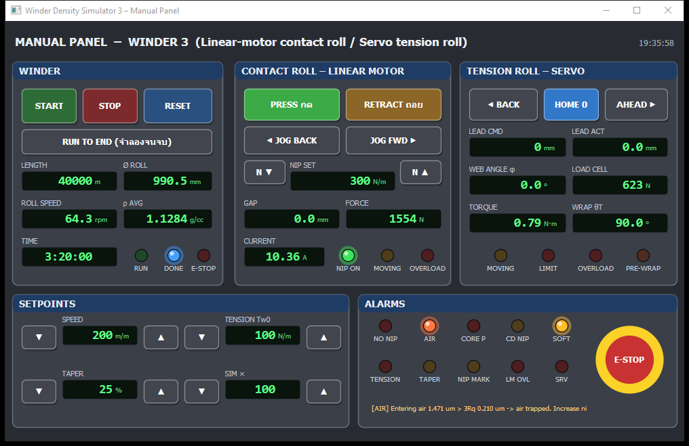

`uManualPanel.TfrmPanel` — HMI วาดด้วย BGRABitmap บน canvas ออกแบบ 1000×600 แล้ว scale ตามหน้าต่าง
คลิกปุ่ม → `OnCommand(PC_*)` → `TfrmMain.DoPanelCmd` (ปรับ slider ในหน้าต่างหลัก จึง sync กันเสมอ)

| กลุ่ม | ปุ่ม (คำสั่ง) | การทำงาน |
|---|---|---|
| WINDER | START (`PC_START`) | เริ่มม้วน (ไม่ได้ถ้า E-STOP หรือม้วนเสร็จ) |
| | STOP (`PC_STOP`) | หยุด |
| | RESET (`PC_RESET`) | รีเซ็ตม้วน + ล้าง E-STOP |
| | RUN TO END (`PC_RUNEND`) | จำลองจนจบ |
| CONTACT ROLL – LM | PRESS / RETRACT | โหมดกด / ถอย (ปุ่มติดไฟตามโหมด) |
| | JOG BACK | ถ้ากดอยู่ → ถอย; ถ้าถอยอยู่ → ระยะถอย +10 mm |
| | JOG FWD | ถ้าถอยอยู่ → ระยะถอย −10 mm; ถ้า ≤ 10 → กด |
| | N ▼ / N ▲ | แรงกด ±10 N/m |
| TENSION ROLL – SERVO | ◀ BACK / AHEAD ▶ | lead ±10 mm |
| | HOME 0 | lead = 0 |
| SETPOINTS | ▼▲ SPEED / TENSION / TAPER / SIM × | ±5 m/min, ±5 N/m, ±5 %, ±5 ขั้น (log) |
| ALARMS | E-STOP | หยุดม้วน + ถอย Contact roll + ล็อก START จนกด RESET |

จอแสดงผล: LENGTH, Ø ROLL, ROLL SPEED, ρ AVG, TIME / NIP SET, GAP, FORCE, CURRENT / LEAD CMD/ACT, WEB ANGLE φ, LOAD CELL, TORQUE, WRAP θT / SPEED, TENSION, TAPER, SIM ×

ไฟ: RUN, DONE, E-STOP / NIP ON, MOVING, OVERLOAD (LM) / MOVING, LIMIT, OVERLOAD, PRE-WRAP (Servo) / Alarm 10 ดวง (NO NIP, AIR, CORE P, CD NIP, SOFT, TENSION, TAPER, NIP MARK, LM OVL, SRV) อ่านจาก tag ใน `GetWarnings` และข้อความคำเตือนแรกแสดงใต้ไฟ

---

## 8. หน้าต่าง Developer

| แท็บ | รายละเอียด | ภาพ |
|---|---|---|
| Live data | ทุกค่า รวม WEB PATH GEOMETRY, TENSION ROLL / LOAD CELL, SERVO, LINEAR MOTOR, CROSS-MACHINE NIP PROFILE, NIP, AIR (hT, hb, hp, he), ผลความหนาแน่น, คำเตือน | 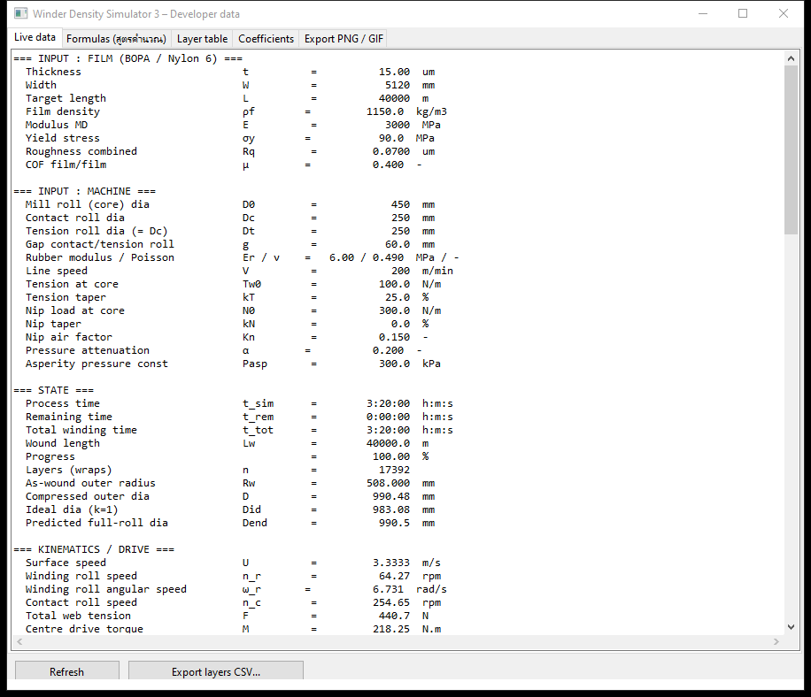 |
| Formulas | สูตรทั้งหมด (หัวข้อ 10) | 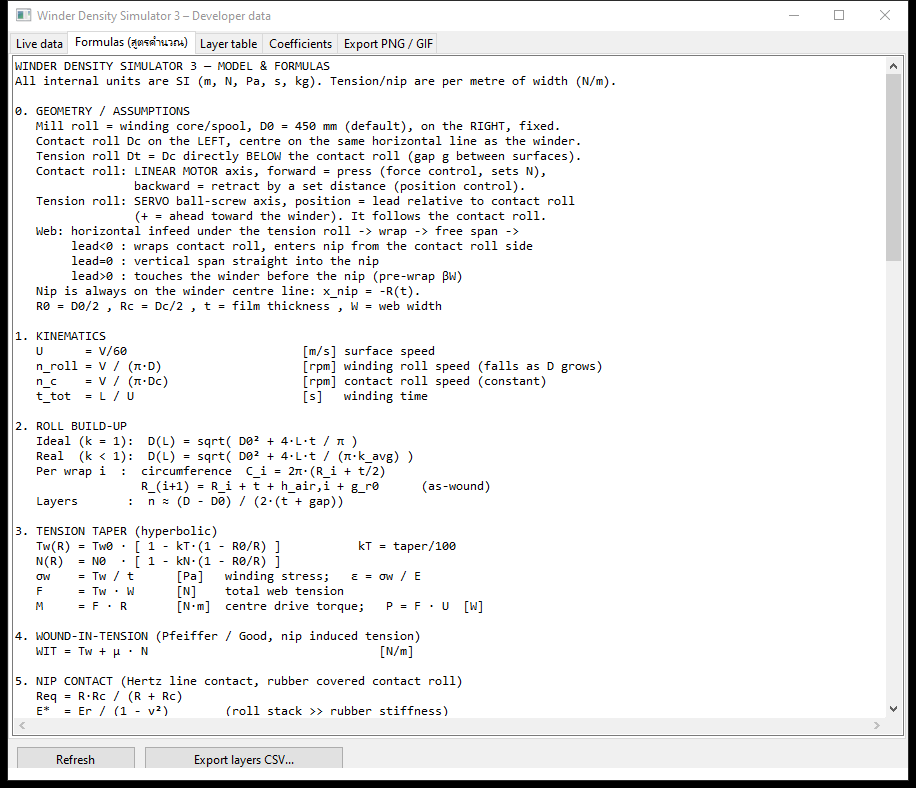 |
| Layer table | ตารางรายชั้น ≤ 300 แถว | 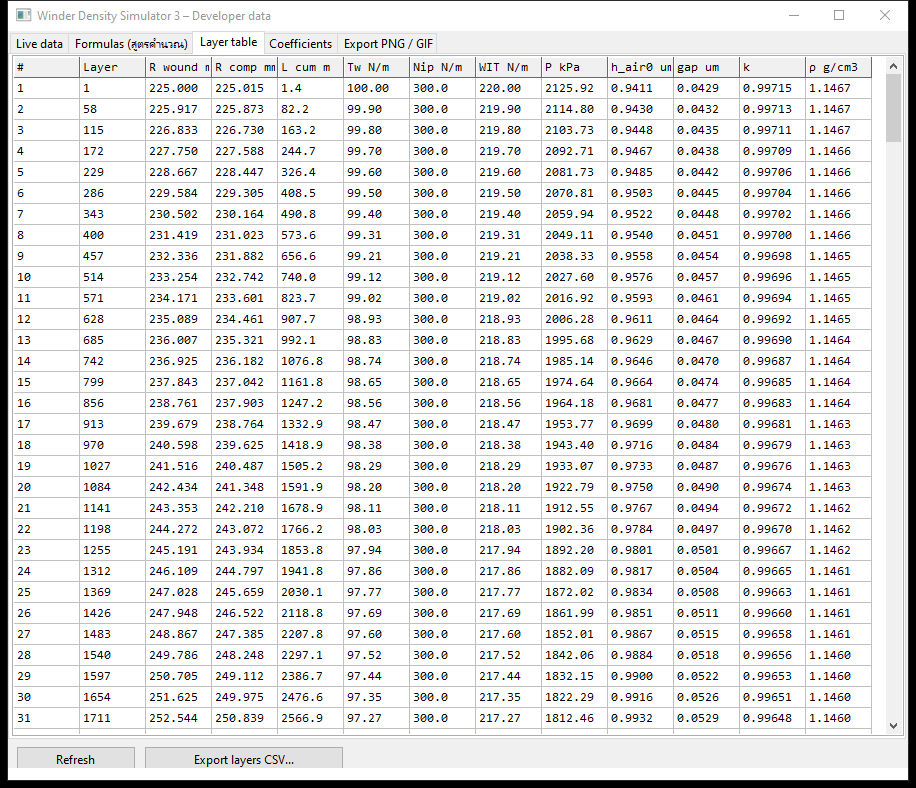 |
| Coefficients | ค่าคงที่ทั้งหมดรวม LM, Servo, Kw, β0, Kb, clearance, crown ฯลฯ | 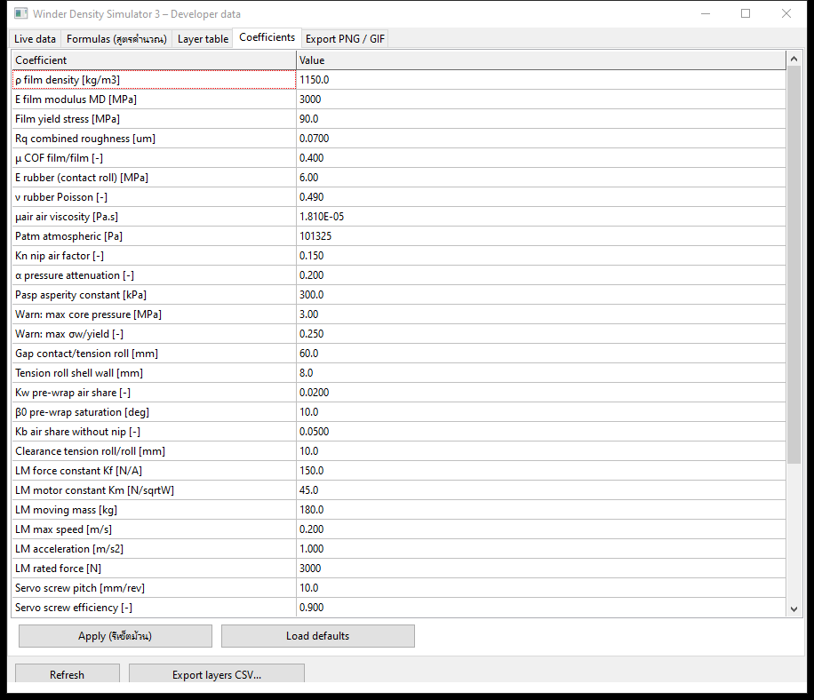 |
| Export PNG / GIF | หัวข้อ 9 | 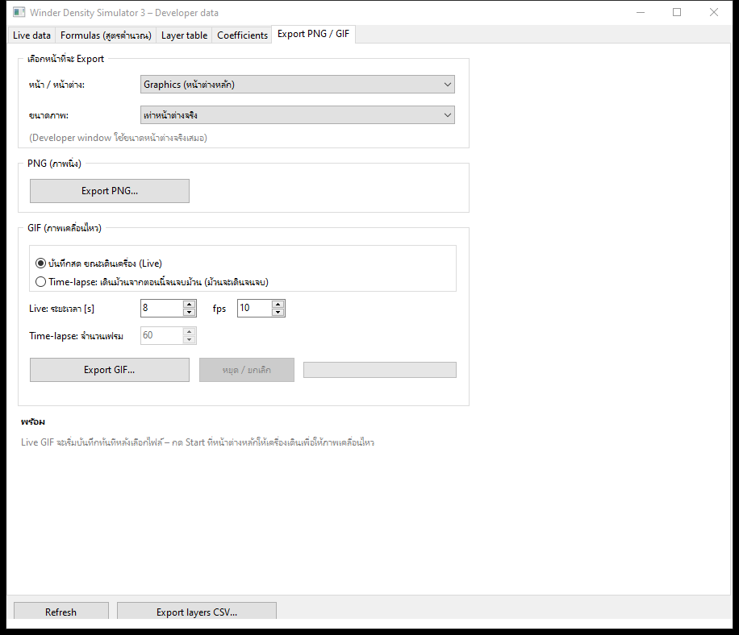 |

**Export layers CSV**: `layer, R_wound_mm, R_comp_mm, L_cum_m, Tw_N_m, Nip_N_m, WIT_N_m, P_kPa, h_air0_um, gap_um, k, rho_g_cm3`

---

## 9. Export PNG / GIF

`uExportTab.TExportPanel` — เลือกหน้า: **Graphics, Cross view, Top View, Manual Panel, Developer window**
(หน้าต่างที่ยังไม่เปิดก็ export ได้ เพราะวาดลง bitmap โดยตรงผ่าน `RenderView`; ถ้าหน้าต่างยังไม่แสดงใช้ 1280×720)

* ขนาด: เท่าหน้าต่างจริง / 960×540 / 1280×720 / 1600×900 / 1920×1080
* PNG ภาพนิ่ง; GIF **Live** (1–120 s, 1–25 fps) หรือ **Time-lapse** (5–300 เฟรม, เดินม้วนจนจบ, เฟรมสุดท้ายค้าง 2.5 s)
* Manual Panel ใช้ `RenderTo(bmp)` ซึ่งเก็บ/คืนค่า scale ของปุ่มบนจอ (hit test ไม่เพี้ยน)

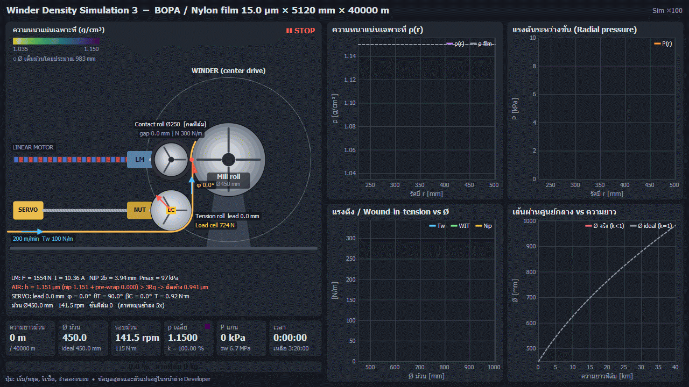

(ไฟล์ [timelapse.gif](images/timelapse.gif) 20 เฟรม 1280×720 ~4.2 MB)

---

## 10. แบบจำลองทางฟิสิกส์และสูตรคำนวณ

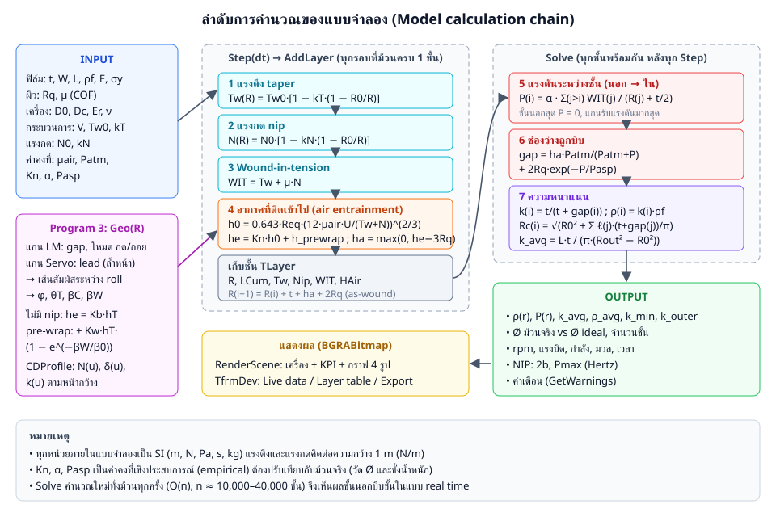

หน่วยภายในเป็น SI; แรงตึง/แรงกดคิดต่อความกว้าง 1 m (N/m)

### 10.1 Kinematics / การโตของม้วน / taper / WIT / Hertz
```
U = V/60 ; n_roll = V/(π·D) ; n_c = n_t = V/(π·Dc) ; t_total = L/U
D_ideal(L) = √(D0² + 4Lt/π) ; D_real(L) = √(D0² + 4Lt/(π·k_avg))
R_(i+1) = R_i + t + h_air,i + 2Rq                         (as-wound)
Tw(R) = Tw0·[1 − kT(1 − R0/R)] ; N(R) = N0·[1 − kN(1 − R0/R)]   (N = 0 เมื่อไม่มี nip)
σw = Tw/t ; F = Tw·W ; M = F·R ; P = F·U
WIT = Tw + μ·N
Req = R·Rc/(R+Rc) ; E* = Er/(1−ν²) ; b = √(4·N·Req/(π·E*)) ; Pmax = 2N/(πb) ; Pmean = N/(2b)
```

### 10.2 อากาศ (รวม pre-wrap และไม่มี nip)
```
ฟิล์มพันม้วนด้วยแรงตึงอย่างเดียว (Knox-Sweeney, R = รัศมีม้วน):
    hT = 0.643 · R · (12·μair·U / Tw)^(2/3)
มี nip:
    h0 = 0.643 · Req · (12·μair·U / (Tw + N))^(2/3)
    he = Kn·h0 + Kw·hT·(1 − exp(−βW/β0))          (pre-wrap เมื่อ lead > 0)
ไม่มี nip (ถอย):
    he = Kb·hT
ha = max(0, he − 3Rq)                              (Kn, Kw, β0, Kb = empirical)
```

### 10.3 แรงดัน / การบีบ / ความหนาแน่น
```
P_i   = α · Σ_(j>i) WIT_j / (R_j + t/2)
gap_i = ha·Patm/(Patm + P_i) + 2Rq·exp(−P_i/Pasp)
k_i   = t/(t + gap_i) ; ρ_i = k_i·ρf
Rc_i  = √(R0² + Σ_(j≤i) ℓ_j·(t + gap_j)/π)          (area conservation)
k_avg = L·t/(π(Rout² − R0²)) ; ρ_avg = k_avg·ρf ; m = ρf·t·W·L
```

### 10.4 แรงกดตามหน้ากว้าง (การแอ่นตัวของ Contact roll) — `CDProfile`
```
shell เหล็ก : ro = Dc/2 − h_rubber , ri = ro − wall
EI = 210e9 · π/4 · (ro⁴ − ri⁴)
คานรับแรงสม่ำเสมอ q = N, ช่วง bearing Lb = W + extra:
    δ(x) = q·x·(Lb³ − 2·Lb·x² + x³) / (24·EI)
Crown (รัศมี) : c(u) = C/2 · (1 − (2u/W)²)      u จากกลางฟิล์ม
ยางเป็น elastic foundation : kf = Er · 2b / h_rubber
N(u) = N + kf·[(δ̄ − δ(u)) + (c(u) − c̄)]   ตัดค่าลบ แล้ว scale ให้เฉลี่ย = N
ρ ชั้นที่กำลังม้วน : k(u) = t / (t + ha(N(u)) + 2Rq)
```

### 10.5 Tension roll / Load cell
```
F_LC = Tw·W·|(−1, 0) + d| = 2·Tw·W·sin(θT/2)      d = ทิศฟิล์มออกจาก Tension roll
Fx   = Tw·W·(dx − 1)                               แรงแนวนอนบนแกน servo
m_t  = 7850·π(Ro² − Ri²)(W + 0.2) ; J_t = m_t(Ro² + Ri²)/2 ; n_t = V/(π·Dt)
ε    = Tw/(E·t) ; τ = Ls/U
```

### 10.6 Servo ball screw
```
F_ax = |Fx| + μg·m·g  (+ m·a ขณะเคลื่อนที่)
T_s  = F_ax · p / (2π·η)                 p = pitch
n_s  = (v_s + v_f)/p · 60 ,  v_f = dR/dt = t·U/(2π·R·k)    (ตาม Contact roll)
การเคลื่อนที่: trapezoidal  v = sign(e)·min(vmax, √(2·a·|e|))
```

### 10.7 Linear motor (Contact roll)
```
F_nip = N·W
แรงฟิล์มบน Contact roll (lead < 0) : Fx_c = −Tw·W·dx ; (path 4) Fx_c = Tw·W·(d2x − d1x)
F_lm  = F_nip − Fx_c + μg·m·g (+ m·a ขณะเคลื่อนที่)
I     = F_lm / Kf ;  P_cu = (F_lm / Km)²
```

### 10.8 ค่าวัสดุ BOPA ทั่วไป
ρf 1.14–1.16 g/cm³, E(MD) 2–4 GPa, σy 60–100 MPa, μ 0.3–0.6, winding stress 4–12 MPa, ยาง 60–80 Shore A (Er ≈ 4–9 MPa)

---

## 11. พารามิเตอร์ทั้งหมด

`TWinderParams` ใน `uwindermodel.pas` (ค่าตั้งต้น `SetDefaults`)

### ฟิล์มและกระบวนการ

| Field | ความหมาย | หน่วย | ค่าตั้งต้น | แก้ที่ |
|---|---|---|---|---|
| ThickUm / WidthMm / LengthM | ฟิล์ม | µm / mm / m | 15 / 5120 / 40000 | Slider |
| RhoFilm / EFilmMPa / YieldMPa | วัสดุ | kg/m³ / MPa / MPa | 1150 / 3000 / 90 | Coefficients |
| RqUm / COF | ผิว | µm / – | 0.07 / 0.40 | Coefficients |
| SpeedMpm | ความเร็วไลน์ | m/min | 200 | Slider |
| TensionNm / TaperPct | แรงตึง / taper | N/m / % | 100 / 25 | Slider |
| NipNm / NipTaperPct | แรงกด / taper | N/m / % | 300 / 0 | Slider |

### เครื่อง

| Field | ความหมาย | หน่วย | ค่าตั้งต้น | แก้ที่ |
|---|---|---|---|---|
| CoreDiaMm | Ø Mill roll | mm | 450 | Slider |
| ContactDiaMm | Ø Contact = Tension roll | mm | 250 | Slider |
| RollGapMm | ระยะห่างผิว Contact ↔ Tension (แนวตั้ง) | mm | 60 | Coefficients |
| TRollWallMm | ผนัง Tension roll | mm | 8 | Coefficients |
| RubberEMPa / RubberNu | ยาง Contact roll | MPa / – | 6 / 0.49 | Coefficients |
| CRollWallMm | ผนังเหล็ก Contact roll | mm | 20 | Coefficients |
| RubberThkMm | ความหนายาง | mm | 15 | Coefficients |
| CrownMm | crown (เส้นผ่านศูนย์กลาง กลาง − ขอบ) | mm | 0.50 | Coefficients |
| BearingExtraMm | ระยะ bearing − หน้ากว้าง | mm | 400 | Coefficients |
| ClearMm | ระยะกันชน Tension roll ↔ ม้วน | mm | 10 | Coefficients |

### Linear motor (Contact roll)

| Field | ความหมาย | หน่วย | ค่าตั้งต้น | แก้ที่ |
|---|---|---|---|---|
| ContactMode | 0 = กด (`CM_PRESS`), 1 = ถอย (`CM_RETRACT`) | – | 0 | ปุ่ม |
| RetractMm | ระยะถอย | mm | 50 | Slider |
| LinKf | force constant | N/A | 150 | Coefficients |
| LinKm | motor constant | N/√W | 45 | Coefficients |
| LinMassKg | มวลเคลื่อนที่ | kg | 180 | Coefficients |
| LinVmax / LinAcc | ความเร็ว / ความเร่ง | m/s / m/s² | 0.20 / 1.0 | Coefficients |
| LinFmaxN | แรงพิกัด | N | 3000 | Coefficients |

### Servo (Tension roll)

| Field | ความหมาย | หน่วย | ค่าตั้งต้น | แก้ที่ |
|---|---|---|---|---|
| LeadCmdMm | lead ที่สั่ง | mm | 0 | Slider / jog / panel |
| ScrewLeadMm | pitch ball screw | mm/rev | 10 | Coefficients |
| ScrewEta | ประสิทธิภาพ screw | – | 0.90 | Coefficients |
| ServoMassKg | มวลเคลื่อนที่ | kg | 90 | Coefficients |
| ServoVmax / ServoAcc | ความเร็ว / ความเร่ง | m/s / m/s² | 0.05 / 0.25 | Coefficients |
| ServoRatedNm | แรงบิดพิกัด | N·m | 2.4 | Coefficients |
| GuideMu | แรงเสียดทาน linear guide | – | 0.01 | Coefficients |

### ค่าคงที่ทางฟิสิกส์และเกณฑ์เตือน

| Field | ความหมาย | หน่วย | ค่าตั้งต้น |
|---|---|---|---|
| AirVisc / Patm | อากาศ | Pa·s / Pa | 1.81e-5 / 101325 |
| NipAirFactor (Kn) | ลดอากาศโดย nip | – | 0.15 |
| PreWrapAir (Kw) | สัดส่วนอากาศ pre-wrap ที่ nip ไล่ไม่ออก | – | 0.02 |
| PreWrapBeta0Deg (β0) | มุมอิ่มตัว pre-wrap | deg | 10 |
| NoNipAir (Kb) | สัดส่วนอากาศเมื่อไม่มี nip | – | 0.05 |
| PressAtten (α) | ลดทอนแรงดัน | – | 0.20 |
| AspPressKPa (Pasp) | การบีบผิว | kPa | 300 |
| MaxCorePressMPa / MaxStressRatio | เกณฑ์เตือน | MPa / – | 3.0 / 0.25 |

### สถานะแกน (ไม่ใช่พารามิเตอร์)
`GapAct, GapVel` (Contact roll), `LeadAct, LeadVel` (Tension roll) — อัปเดตใน `UpdateAxes(dt)` ด้วย `MoveAxis`

---

## 12. คำเตือน (Warnings)

| Tag | เงื่อนไข | ไฟใน Panel |
|---|---|---|
| `[NO NIP]` | Contact roll ไม่ได้กด | NO NIP |
| `[AIR]` | he > 3Rq | AIR |
| `[PRE-WRAP]` | βW > ~1° | PRE-WRAP (Servo) |
| `[SERVO]` (limit) | lead ถูก collision guard จำกัด | LIMIT / SRV |
| `[CD]` | N_min < 70% ของ N เฉลี่ยตามหน้ากว้าง | CD NIP |
| `[LM]` | F_lm > LinFmaxN | LM OVL / OVERLOAD |
| `[SERVO]` (torque) | T_s > ServoRatedNm | SRV / OVERLOAD |
| `[TENSION]` | σw > MaxStressRatio·σy | TENSION |
| `[CORE]` | P_core > MaxCorePressMPa | CORE P |
| `[SOFT]` | k_outer < 0.95 | SOFT |
| `[TAPER]` | Tw < 30% Tw0 | TAPER |
| `[NIP]` | Pmax > 1 MPa | NIP MARK |

---

## 13. ผลลัพธ์อ้างอิง

ค่าตั้งต้น 15 µm × 5120 mm × 40,000 m, 200 m/min, Tw0 100 N/m (taper 25 %), N0 300 N/m

| กรณี | φ | มุมพัน | Ø ม้วนเต็ม | k_avg | ρ_avg (g/cm³) |
|---|---|---|---|---|---|
| lead = 0 (กด) | 0° | θT 90° | 990.5 mm | 98.12 % | 1.1284 |
| lead = −80 mm (กด) | +14.5° | θT 75.5°, βC 14.5° | 990.5 mm | 98.12 % | 1.1284 |
| lead = +80 mm → จำกัด 70.6 (กด) | −19.0° | θT 109°, βW 19° | 1002.5 mm | 95.20 % | 1.0948 |
| Contact roll ถอย 50 mm | +8.0° | θT 82° | 1039.2 mm | 87.07 % | 1.0013 |

ค่าอื่นที่ lead = 0 (ตอนจบม้วน):

| ค่า | ผล |
|---|---|
| Linear motor | F = 1,554 N, I = 10.36 A (ต่อข้าง 777 N) |
| Load cell | 623 N (ต่อข้าง 312 N) |
| Servo torque | 0.79 N·m (ต่อข้าง ~0.40 N·m) |
| Nip | 2b = 4.41 mm, Pmax = 87 kPa |
| Contact roll | EI = 13.33 MN·m², δmax = 0.272 mm |
| Nip ตามหน้ากว้าง (crown 0.5 mm) | 280–307 N/m (crown 0 → ประมาณ 240–400 N/m) |
| P ที่แกน / มวล / เวลา | 2,126 kPa / 3,533 kg / 3:20:00 |

---

## 14. โครงสร้างโค้ด

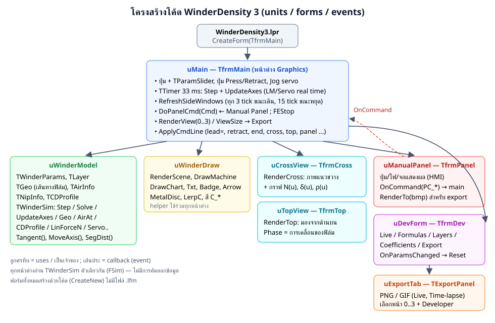

| ไฟล์ | บรรทัด | หน้าที่ |
|---|---|---|
| `WinderDensity3.lpr` | 20 | program |
| `WinderDensity3.lpi` | 136 | project (BGRABitmapPack, LCL; Default + Debug) |
| `uwindermodel.pas` | ~1,000 | แบบจำลอง, แกน LM/Servo, เรขาคณิต `Geo`, `CDProfile` |
| `uwinderdraw.pas` | 642 | `RenderScene`, `DrawMachine` + helper ที่ใช้ร่วม (`Txt`, `Badge`, `Arrow`, `DrawChart`, สี `C_*`) |
| `ucrossview.pas` | 306 | Cross view |
| `utopview.pas` | 358 | Top View |
| `umanualpanel.pas` | 400 | Manual Panel (HMI) |
| `umain.pas` | ~700 | หน้าต่างหลัก, timer, sliders, `DoPanelCmd`, export callbacks, command line |
| `udevform.pas` | ~770 | Developer |
| `uexporttab.pas` | 408 | Export PNG/GIF |

### ลำดับการทำงานหลัก

```
TTimer 33 ms ─► TfrmMain.TimerTick
   ├─ ถ้าเดิน: FSim.Step(dt·SimMult)  → AddLayer (Geo → AirAt ต่อชั้น) → Solve
   │           มุมหมุนภาพ, FTop.Phase += U·dt·0.2
   ├─ ถ้าแกนยังไม่ถึงเป้า: FSim.UpdateAxes(dt)   ← เวลาจริง
   ├─ RefreshSideWindows: ทุก 3 tick (เดิน/แกนเคลื่อน) หรือ 15 tick (หยุด)
   │       Cross view, Top View, Manual Panel (Invalidate)
   └─ ทุก 15 tick: Developer RefreshData
Manual Panel click ─► OnCommand(PC_*) ─► DoPanelCmd ─► ปรับ slider/ปุ่ม ─► ParamsToSim
```

### โครงสร้างข้อมูลสำคัญ

| Type | ใช้ทำอะไร |
|---|---|
| `TGeo` | ผลเรขาคณิตต่อรัศมี: จุดศูนย์กลาง roll, gap, lead/leadMax/Limited, PathType, มุม arc (TA0/TA1, CA0/CA1, WA0), span 1–2, ทิศ d1/d2, θT, βC, βW, φ, ความยาว span |
| `TAirInfo` | U, Req, Teff, hT, h0, hb, hp, he, hc, ha, NoNip |
| `TNipInfo` | Req, E*, b, Pmax, Pmean |
| `TCDProfile` | X, Nip, Defl, KOut (arrays), Span, EI, kf, δmax, Nmin/Nmax/Navg |
| `TLayer` | R, LCum, Tw, Nip, WIT, HAir, P, Gap, K, Rc |

### ข้อควรระวัง
* ฟอร์มทุกตัวสร้างด้วยโค้ด (`CreateNew`) ไม่มี `.lfm`; หน้าต่างย่อยเป็นของ `TfrmMain` (Owner)
* `with Layers[i] do` → `r`/`P` ชี้ field ของชั้น; ตัวแปร local ชื่อ `u` ชนกับ method `U` (ความเร็ว) — ใช้ `uc`
* ชื่อ parameter ซ้ำ field ใน `with` (เช่น `AddBtn(x1...)` กับ `TPBtn.X1`) → ตั้งชื่อ `ax1`
* Typed const ของ `TBGRAPixel` ขึ้นกับลำดับ field ของแพลตฟอร์ม → ตั้งค่าสีใน `initialization` แทน
* ค่าตั้งต้นของ parameter (default) ใส่ได้ที่ interface เท่านั้น ส่วน implementation ไม่ต้องใส่ซ้ำ
* UTF-8 ไม่มี BOM, ไม่ใส่ `{$codepage utf8}`; ตัวเลขใช้ `FF()`/`FSDot`

---

## 15. วิธีเพิ่ม/แก้ไขความสามารถ

* **พารามิเตอร์ใหม่**: `TWinderParams` → `SetDefaults` → slider (`AddSlider`, `SimToSliders`, `ParamsToSim`) หรือ Coefficients (`KEY_`, `LoadCoefs`, `BtnApplyClick`) → `FillLive` → `FillFormulas`
* **คำสั่งใหม่ใน Manual Panel**: เพิ่มค่าคงที่ `PC_xxx` → `AddBtn(...)` ใน `CreatePanel` (พิกัด canvas 1000×600) → `case` ใน `DoPanelCmd` → (ถ้าเป็นปุ่มติดไฟ) `Lit`
* **ไฟ/จอใหม่ใน Panel**: เรียก `Lamp(x, y, caption, color, on)` / `Disp(x1, y1, x2, caption, value, unit)` ใน `DoRender`
* **หน้าต่างภาพใหม่**: สร้าง unit แบบ `uTopView` (form + `RenderXxx(bmp, Sim)`), สร้างใน `TfrmMain.Create`, เพิ่มใน `RefreshSideWindows`, `SetViews`, `RenderView`, `ViewSize`
* **โมเดลอากาศ/เส้นทางใหม่**: แก้ `Geo` (เส้นทาง) และ `AirAt` (อากาศ) — `AddLayer` เรียกทั้งคู่ต่อชั้นอยู่แล้ว
* **ควบคุมแกนแบบอื่น** (เช่น PID แรงกด): แทนที่ `MoveAxis` ใน `UpdateAxes` และคำนวณ N จากการกดจริงแทน `NipSet`

---

## 16. ข้อจำกัดและแนวทางพัฒนาต่อ

**ข้อจำกัด**
* ค่าคงที่ Kn, α, Pasp, Kw, β0, Kb เป็น empirical — ต้องปรับเทียบกับม้วนจริง (Ø + น้ำหนัก → ρ_avg)
* ค่า LM/Servo/ระยะ/crown เป็นค่าสมมติ — ใส่ค่าจริงจากเครื่องในแท็บ Coefficients
* แรงกด N เมื่อกด = ค่าตั้งทันที (ไม่มี dynamics ของ force loop); แกนเคลื่อนแบบ trapezoidal ไม่มี following error
* CD profile ใช้คานรับแรงสม่ำเสมอ + ยางเป็น foundation แบบเชิงเส้น, ไม่รวมการแอ่นของม้วน/แกน Winder, ไม่ใช้ CD profile กับทุกชั้น (ใช้เฉพาะชั้นที่กำลังม้วน)
* Time-lapse/Run to end ใช้ตำแหน่งแกนปัจจุบัน (lead ถูก clamp ทันทีใน `Geo`)

**แนวทางพัฒนาต่อ**
1. ปรับเทียบอัตโนมัติจากข้อมูลจริง (fit Kn, α, Kw)
2. Force-control loop ของ Linear motor (PI + ความแข็งยาง) และ tension control จาก load cell
3. CD density 2 มิติ (ทุกชั้น × หน้ากว้าง) + gauge profile
4. Recipe บันทึก/โหลด, log ข้อมูลตามเวลา (CSV), เชื่อม PLC (Modbus/OPC UA) ใช้ Manual Panel เป็น HMI จริง
5. Hakiel nonlinear stack model แทน α

---

## 17. ประวัติการเปลี่ยนแปลง

| ครั้ง | รายการ |
|---|---|
| 1 | สร้างจาก Program 2: Linear motor (กด/ถอย, แรงกด), Servo lead, เส้นทางฟิล์มจากเส้นสัมผัส, pre-wrap/no-nip air |
| 2 | หน้ากว้างค่าตั้งต้น 5120 mm, LinFmaxN 3000 N |
| 3 | Cross view (ภาพแนวขวาง) + CD nip profile (การแอ่นตัว + crown 0.5 mm), Manual Panel (HMI, E-STOP) |
| 4 | Top View |
| 5 | แท็บ Export PNG / GIF (5 หน้า), command line options + เอกสารนี้ |
